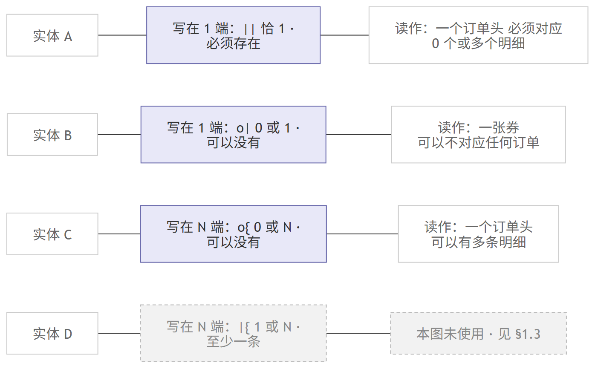

# ER 设计说明与验证记录

> **产出周**：第 5 周（ch6 ER 模型）—— 课程「本周作业」**第 4 项**
> **课程依据**：[`course/lecture-week05.md`](../../course/lecture-week05.md) L51
> **本文档的性质**：**说明与证据**，不新增设计。设计本身在
> [`er-diagram.md`](er-diagram.md)（图）与 [`business-rules.md`](business-rules.md)（规则）里。
> **配套**：[`v0.1-issues.md`](v0.1-issues.md)（问题清单）· [`er-legend.png`](er-legend.png)（符号图例）

---

## 0. 课程要求与本文档的对应

| 课程原文要求 | 本文档章节 |
|---|---|
| 说明 **ER 图的设计思路** | §1 |
| 展示 **多商品订单** 在图和数据库中的对应关系 | §2.1 |
| 展示 **会员或散客购买** 在图和数据库中的对应关系 | §2.2 |
| 展示 **库存查询** 在图和数据库中的对应关系 | §2.3 |
| 附 **符号图例** | §3（图形版 `er-legend.png` + 读法） |
| **验证记录** | §4 |

> **写作立场**：三个场景一律按「**业务语言 → 图上哪条线 → 库里哪个约束**」三段给出。
> 只画图不给约束不算完成 —— 因为**能拦住错误的从来不是线，是约束**。

---

## 1. ER 图的设计思路

### 1.1 为什么是「逆向梳理」而不是「重新建模」

v0.1 已经落地 17 张表并有 20,979 行数据。第 5 周的任务不是推翻它重画，
而是**把已实现的物理结构还原成概念层**，再看它讲不讲得通。这个起点的选择决定了后面所有动作：

| 选择 | 理由 | 代价 |
|---|---|---|
| **从 DDL 逆向**，不从业务故事重画 | 若重画，得到的图与库必然对不上，第 6 周无法据它做迁移 | 容易被**现有实现的缺憾**带着走，看不出"本该有而没有"的东西 |

为压制这个代价，§2 的三个场景与 [`v0.1-issues.md`](v0.1-issues.md) 都是**拿业务规则去撞库**，
而不是反过来复述库。**三条真缺口都是撞出来的**（券核销时间、`subtotal` 一致性、券状态机）。

### 1.2 为什么用 Crow's Foot

| 理由 | 说明 |
|---|---|
| **物理模式原生** | 本图从物理表逆向而来，Crow's Foot 直接表达「外码在哪张表」——正是 DDL 的形状 |
| **Mermaid 原生支持** | [`03-documentation.md`](../../harness/conventions/03-documentation.md) §4 要求「图用 Mermaid，不用截图」，而 Mermaid 只原生支持 Crow's Foot |
| **可版本控制** | 纯文本源码，改动在 git 里可 diff、可搜索 |

### 1.3 三个明确的取舍（**都有代价，都补了**）

**取舍一：用 Crow's Foot，换来的是丢失「参与约束」的表达力。**
鸦爪的符号位只有「1 端 / N 端」两个，**表达不了"1 端是否必须参与"**（四个约束只有三个符号）。
**补偿**：在 [`business-rules.md`](business-rules.md) §2 逐段写出两端的 `(min, max)` ——
图画不出的信息用表补，**而不是假装它不重要**。

**取舍二：只画「码 + 关键业务属性」，不画全 137 列。**
**代价**：图中属性**是摘录**，不是完整字典。
**补偿**：§2.0 明写「完整字段一律以 [`data-dictionary.md`](data-dictionary.md) 为准」，并在 §4 做**命名对应校验**。

**取舍三：关系标签用 `R01`—`R31` 编号，不用外码名。**
这是**踩坑之后的决定**：33 字符的约束名（如 `fk_order_detail_topping_topping`）
在 3809 px 宽的画布上**被折行截断**；改用短标签又**两两冲突、且与列名冲突**
（`ingredient` / `product` / `cup_spec` 都重复）。
**代价**：读者无法从图上直接读出外码名。
**补偿**：[`er-diagram.md`](er-diagram.md) §2.1 给完整的「编号 → 外码」映射表，
且 §4 做了**机器比对：31 个编号 ↔ 31 个外码一一对应**。

### 1.4 一个设计上「有意留白」的地方

[`er-diagram.md`](er-diagram.md) §1.3 记录了本图**有意未使用 `|{`（1 或 N）符号**。
它要表达的是「一张订单至少要有一条明细」，而这需要**反向断言** ——
外码建在明细表上，只能保证「明细必有订单头」，**方向正好相反**；`CHECK` 也看不到别的表。

**不画它，是因为画上就是假的。** 这两条缺口已登记为
[`business-rules.md`](business-rules.md) §4 的 **A1 / A2**。

---

## 2. 三个场景的对应关系

### 2.0 读前须知

- 图中**实体名 = 表名去掉 `tbl_` 前缀**（如 `order_header` ↔ `tbl_order_header`）。
- 图中属性**是摘录**，完整 137 字段见 [`data-dictionary.md`](data-dictionary.md)。
- 关系标签 `Rxx` 的完整映射表见 [`er-diagram.md`](er-diagram.md) §2.1。

### 2.1 场景一：多商品订单

**业务语言**：「一位顾客点了 2 杯珍珠奶茶（都半糖）+ 1 杯草莓奶昔。」

| 层 | 对应关系 |
|---|---|
| **图上** | `order_header` —(**R05**)— `order_detail` 是 1:N；`order_detail` —(**R08**)— `product` 是 N:1；`order_detail` —(**R09/R10/R11**)— `spec_option` **出现三次**（杯型 / 糖度 / 冰度各一个外码） |
| **库里** | `fk_order_detail_order` → `tbl_order_header`；`fk_order_detail_product` → `tbl_product`；`fk_order_detail_{cup,sugar,ice}_spec` → `tbl_spec_option`（**同一张目标表挂三个外码**，靠列名区分） |

**⭐ 这一条回答课程提示第 2 条**：**"不要默认同一商品在一张订单只出现一次。"**

关键在唯一性建在哪一列上：

| 约束 | 建在 | 后果 |
|---|---|---|
| `uq_order_detail_order_line` | `(order_id, line_no)` | ✅ **同一订单里同一个 `product_id` 可以出现多次** —— 2 杯奶茶就是 2 行明细 |
| （不存在） | ~~`(order_id, product_id)`~~ | 若建在这里，2 杯奶茶就**只能写 1 行**，靠 `qty` 凑数 → **丢掉了"每杯可单独选甜度"的能力** |

> **答辩要点**：`line_no` 是**该行在订单里的序号**，不是商品序号。
> 三者（同商品多行、独立规格、加料挂明细）合起来，才使「2 杯奶茶分别半糖全冰 + 1 杯奶昔」可表达。

**图与库的差距（如实登记）**：「订单至少有一条明细」**外码表达不了** ——
`fk_order_detail_order` 建在**明细**表上，只能保证「明细必有订单」，**方向相反**。见 A1。

### 2.2 场景二：会员或散客购买

**业务语言**：「会员扫码可以打折积分；路过的散客直接买一杯。」

| 层 | 对应关系 |
|---|---|
| **图上** | `order_header` —(**R02**)— `member`；看**左端符号**。`coupon` —(**R04**)— `order_header` 同理 |
| **库里** | `fk_order_header_member` EXISTS，**但 `member_id` 列允许 NULL** → 外码**只在非空时**生效 |
| **结论** | ⭐ **决定最小基数的是「列可不可空」，不是「有没有外码」** |

**这三种写法是完全不同的三件事**，本场景考的正是区分它们：

| 写法 | 含义 | 本项目 |
|---|---|---|
| 有外码 + 列 `NOT NULL` | 1 端**必须参与** | ❌ 不适用（会禁止散客） |
| 有外码 + 列 `NULL` | 1 端**可以**参与，也可以不参与 | ✅ **本项目采用** |
| 无外码 | 完全不记录这层关系 | ❌ 不适用 |

`business-rules.md` §3 对**全部 31 个外码**逐个标注了「列可空 → 决定的最小基数」，
本场景是其中 `member_id` / `coupon_id` 两条。

> **答辩要点**：`member_id` 可空**不是"忘了加 NOT NULL"**，是**散客可下单**这条业务规则的直接体现。
> 反过来说：若把它改成 `NOT NULL`，库就再也**表达不了散客**了 —— 这是**约束即业务语义**的典型例子。

### 2.3 场景三：库存查询（"还能做几杯？"）

**业务语言**：「还剩多少原料，还能做几杯？」

| 层 | 对应关系 |
|---|---|
| **图上** | ⚠️ **这个场景在图里没有对应实体** —— 因为它是**派生数据**。图上只有它的**输入**：`recipe`（**R14/R15/R16/R17**）、`ingredient`（`qty_on_hand`）、`product`（`is_sold_out`） |
| **库里** | **视图** `vw_product_stock_availability` —— **木桶原理**：`MIN(FLOOR(原料结存 ÷ 配方用量))`，再融合**物理售罄**与**人工沽清**双重判定 |

**这条"对应关系"本身就是一条设计说明**：

| 若做成表 | 做成视图（本项目） |
|---|---|
| 每次销售都要同步更新，**漏一次就永久错**，且产生第二真相源 | 查询时**按需计算**，真相源唯一（`tbl_ingredient.qty_on_hand`） |
| 违反 D-12「可推导数据不进库」 | 遵守 |

**读法示范**：`vw_product_stock_availability` 不存储任何数字，它**读**三张表在**查询那一刻**算出结果。
所以「还能做几杯」**永不过期** —— 它没有"过期"这个概念。

> **答辩要点**：课程问「库存查询在图和数据库中的对应关系」，
> 而**正确答案恰恰是"图上没有对应的实体"** —— 这需要**解释得了**，而不是去找一个不存在的框。
> 若真把它画成实体，第 6 周规范化就会立刻把它挑出来（违反 3NF）。

---

## 3. 符号图例



> **矢量版**：[`er-legend.svg`](er-legend.svg)（纯 `<text>` 标签，`foreignObject` 计数 = 0，Word/PPT 可直接插入）
> **源文件**：[`er-legend.mmd`](er-legend.mmd)（Mermaid，可改可重渲染）

**两个符号位，各写一端**：`A ⟨写在 1 端旁⟩--⟨写在 N 端旁⟩ B`

| 符号 | 写在 | 含义 | 本图实际出现 |
|---|---|---|---|
| `\|\|` | **1 端** | 恰 1 · 必须存在 | **21** 次 |
| `o\|` | **1 端** | 0 或 1 · 可以没有 | **9** 次 |
| `o{` | **N 端** | 0 或 N · 可以没有 | **30** 次 |
| `\|{` | **N 端** | 1 或 N · 至少一条 | **0** 次 —— 见 §1.4 |

**读法**：`order_header ||--o{ order_detail : "R05"`
→ 「**一个订单头，必须对应 0 个或多个订单明细**」。
`coupon o|--o{ order_header : "R04"` → 「**一张券可以不对应任何订单，也可以对应多张**」。

> ⚠️ **本章为更正版** —— 原表把左右端符号排反（把 N 端的 `o{` 记到 1 端），
> 且列了一个全文出现 0 次的 `|{` 却在正文里没说清它为何不用。
> 更正依据是对 `er-diagram.mmd` **全部 31 条关系做符号统计**，数字见上表「本图实际出现」列。

---

## 4. 验证记录

> **全部为脚本实测值**，非引用既有文档。脚本：
> [`harness/logs/tmp-verify-naming.py`](../../harness/logs/tmp-verify-naming.py)（命名与关系）、
> [`harness/logs/tmp-count-cols.py`](../../harness/logs/tmp-count-cols.py)（列数）。
> ⚠️ 两脚本为**临时校验脚本**，放在 gitignore 区，**不随交付物提交**。

### 4.1 ⭐ 命名对应校验（**课程硬要求**）

课程要求「**图中命名能对应到数据字典**」。此项为**机器比对**，三向核对：

| 校验 | 方法 | 结果 |
|---|---|---|
| **实体名 ↔ 真实表名** | 18 个实体名逐个匹配 `tbl_<名>`（从 `create-tables.sql` + `11-migration/migration.sql` 解析） | **18 / 18 全部命中**，0 个找不到表 |
| **属性名 ↔ 真实列名** | 图中 **80 个属性**逐个核对是否真是该表的列 | **80 / 80 全部存在**，0 个臆造列 |
| **命名 ↔ 数据字典** | 18 实体名 + 85 属性名共 **103 个命名位**，逐个在 `data-dictionary.md` 中检索 | **103 / 103 全部出现**，0 个字典里没有的命名（去重后 **78 个不同名**，因 25 个名字同时充当实体名与列名） |

**结论：图中零自造命名。**

> ⚠️ **过程中出现过一次假警报**：首轮跑出 `recipe.ingredient_id` 不存在。
> 复查发现是**校验脚本自己的缺陷** —— 它没剥行内注释，
> `sugar_spec_id ... -- NULL ＝ ...` 这行把后继列 `ingredient_id` 吞进了同一段。
> **修好解析器后 0 错**。记在这里是因为：**校验工具本身也会错，报错先怀疑工具。**

### 4.2 结构与关系校验

| 校验项 | 实测值 | 得出方式 |
|---|---|---|
| 实体数 | **17** | 解析 `.mmd` 的实体块 |
| 关系数 | **30** | 解析 `.mmd` 的关系行 |
| 关系标签完整性 | **R01—R31 连续且唯一，31/31** | 标签集合比对 |
| 图中 `PK` 标记 | **= 17 个主码** | 与 DDL 逐一核对 |
| **31 条关系 ↔ 31 个外码** | **一一对应** | 外码名逐条比对 `constraints.sql`（30 个）+ `migration.sql`（`fk_coupon_template` 1 个） |
| `.md` 代码块 ↔ `.mmd` | **各 146 行，逐行一致** | 两文件比对 |

### 4.3 对象计数校验（可复查）

| 对象 | 实测值 | 文件 |
|---|---|---|
| `CREATE TABLE` | **17** | `project/sql/01-schema/create-tables.sql` |
| **逐表列数合计** | **132** | 同上，**括号感知解析**（剔除表级约束） |
| `CREATE INDEX` | **21** | `project/sql/03-indexes/indexes.sql` |
| **`CREATE OR ALTER VIEW`** | **5** | `project/sql/07-view/view.sql` |
| `CREATE ROLE` | **4** | `project/sql/08-security/role.sql` |
| `FOREIGN KEY` / `CHECK` / `UNIQUE` | **30 / 43 / 17** | `project/sql/02-constraints/constraints.sql` |

> ⚠️ **两条会让人算错的坑（踩过）**：
>
> 1. **主码不在 `constraints.sql` 里** —— 该文件 `PRIMARY KEY` 出现 **0 次**，
>    17 个 `pk_*` 全部**内联在 `create-tables.sql` 建表时**。按 `constraints.sql` 数主码会得 0。
> 2. **视图写法规是 `CREATE OR ALTER VIEW`**（幂等，可反复重跑）。
>    按 `CREATE VIEW` 搜 **必然得 0** —— 这不是文件有问题。

### 4.4 导出图可用性校验

| 校验项 | 结果 |
|---|---|
| `er-diagram.svg` 的 `foreignObject` 计数 | **0**（纯 `<text>`，369 个）→ **Word / PPT 可直接插入** |
| `er-legend.svg` 的 `foreignObject` 计数 | **0**（纯 `<text>`，20 个） |
| ER 图 PNG 尺寸 | **6537 × 2511**，`viewBox 6.25 0 4357.41 1673.75` |
| 图例 PNG 尺寸 | **1396 × 866**，`viewBox 0 0 697.74 432.4` |
| 实体是否被裁切 | ✅ 逐实体放大复核，**无裁切** |

> ⚠️ **为什么必须是 0**：Mermaid 默认 `htmlLabels` 会产出 `<foreignObject>` + XHTML，
> **Word/PPT 无法解析，插入后是空白框**。本项目固定用配置
> `{"htmlLabels": false, "er": {"useMaxWidth": false}, "flowchart": {"htmlLabels": false}}`。
> 另：`mermaid-cli` 的**配置文件必须是 UTF-8 无 BOM** —— 带 BOM 会报
> `SyntaxError: Unexpected token '', "{htmlLab"... is not valid JSON`（**与项目里 `.sql` 需带 BOM 的规则相反**）。

**重渲染命令**（在本仓根目录执行）：

```powershell
# 渲染前需准备两个临时文件（内容如下，均须 UTF-8 无 BOM）：
#   mermaid-config.json  {"htmlLabels": false, "flowchart": {"htmlLabels": false, "useMaxWidth": false},
#                         "er": {"useMaxWidth": false}}
#   puppeteer.json       {"args": ["--no-sandbox", "--disable-gpu"],
#                         "executablePath": "<本机 Edge 路径>"}

npx -y @mermaid-js/mermaid-cli@11 -i project\docs\er-diagram.mmd -o project\docs\er-diagram.png `
    -b white -c mermaid-config.json -p puppeteer.json -w 4200 -H 3000 -s 1.5

npx -y @mermaid-js/mermaid-cli@11 -i project\docs\er-legend.mmd -o project\docs\er-legend.png `
    -b white -c mermaid-config.json -p puppeteer.json -w 1600 -s 2
```

> ⚠️ **两个渲染参数的坑**：`-w` 生效，但 **`-H` 会被忽略** —— PNG 的高度由 `viewBox` 内容决定；
> 画布过紧会**裁掉实体下方行**（本图曾因此丢掉 `recipe.product_id`）。
> 另：`puppeteer.json` 的 `executablePath` **是本机绝对路径，不可提交**，故两个配置文件都留在 gitignore 区。


### 4.5 验证状态与遗留事项

| 项 | 状态 / 说明 |
|---|---|
| **`99-rebuild.sql` 在本机实跑** | ✅ **已补跑通过**（2026-10-19，文件策略放开为 danger-full-access 后）：`exit=0`，回显 **18 表 / 137 字段 / 31 外键 / 44 CHECK / 22 索引 / 6 视图 / 4 安全角色**，逐表行数合计 **20,979**；另实测约束行为与 `migration.sql` 连续两次幂等执行均 `exit=0`。原记「沙箱无法连接实例（实例只听命名管道）」是第 5 周当时的真实限制，现已不适用 |
| 校验脚本未入库 | `tmp-verify-naming.py` / `tmp-count-cols.py` 是一次性校验脚本，放在 `harness/logs/` 且已被 `.gitignore` 的 `harness/logs/tmp-*` 排除。**结论已写进本文档**，脚本可随时重跑；若要长期回归，应移入 `project/tests/` 并走代码分支（那段路要过 `99-rebuild.sql` 合并底线） |
| 图中属性摘录 vs 数据字典全量 | **有意为之**（§1.3 取舍二），非缺陷 |

---

## 5. 与其它文档的关系

| 文档 | 关系 |
|---|---|
| [`er-diagram.md`](er-diagram.md) | **图本身** + 符号图例表 + R 编号映射表 |
| [`business-rules.md`](business-rules.md) | **规则本身**：29 段联系的 `(min,max)` / 31 外码 / **A1—A10 库表达不了的规则** |
| [`v0.1-issues.md`](v0.1-issues.md) | **问题清单**：3 处完整性缺口 + 第 6 周迁移输入 |
| [`data-dictionary.md`](data-dictionary.md) | **唯一真相源**：18 表 / 137 字段的权威定义 |
| [`design-notes.md`](design-notes.md) | 阶段一的**设计取舍与已知边界**（跨周累积） |

> **本文档不复制上述内容**，只做**说明与证据**。若与上述任何一份冲突，**以上述为准** ——
> 本文档只负责解释它们，不负责定义它们。
