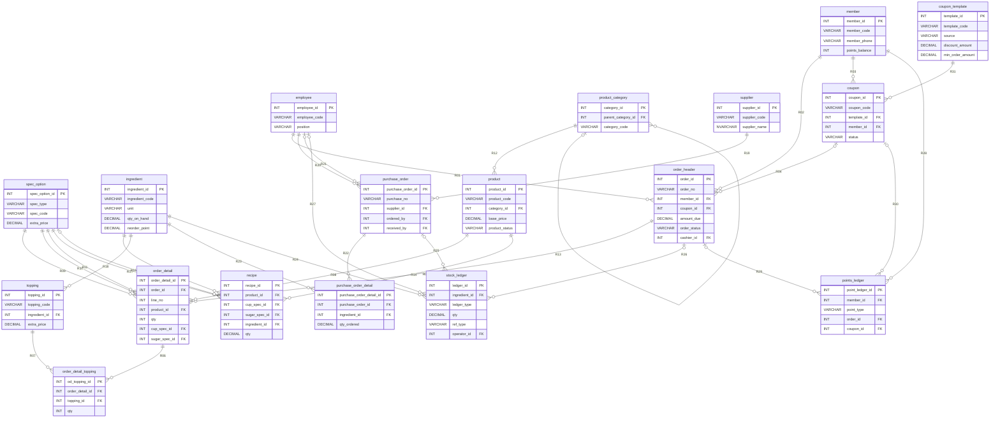

# ER 图 · 茶颜小铺（单店）

> **产出周**：第 5 周（ch6 ER 模型）
> **课程依据**：[`course/lecture-week05.md`](../../course/lecture-week05.md) —— 第五周任务 ch6 ER 模型
> **建模对象**：`v1.0` 数据库设计（**18 张表 / 137 字段 / 31 外码**）。
> 前 17 张表与 132 字段来自对 `v0.1` 的逆向梳理；第 18 张 `tbl_coupon_template`
> 与第 31 个外码 `fk_coupon_template` 由**第 6 周券表拆分迁移**新增（ISSUE-013 定案）。
> **配套**：[`business-rules.md`](business-rules.md)（基数与规则清单）· [`v0.1-issues.md`](v0.1-issues.md)（问题清单）
> **命名对应**：图中每个实体名与属性名**逐一对应 [`data-dictionary.md`](data-dictionary.md)**，无自造命名

---

## 1. 表示法：为什么用 Crow's Foot，不用 Chen

课程要求「**统一使用一种表示法，附符号图例**」。本项目选 **Crow's Foot（鸦爪）**：

| 理由 | 说明 |
|---|---|
| **物理模式原生** | 本图是**从 v0.1 物理表逆向**出来的。Crow's Foot 直接表达「外码在哪张表」——正是 DDL 的形状 |
| **Mermaid 原生支持** | `harness/conventions/03-documentation.md` §4 要求「图用 Mermaid，不用截图」，而 **Mermaid 只原生支持 Crow's Foot** |
| **可版本控制** | 纯文本源码，改动在 git 里可 diff、可搜索 |

> ⚠️ **唯一被牺牲的表达力**：「1 端是否必须参与」无法用鸦爪直接画出（三个符号表达不了四种约束）。
> **补偿办法**：在 §5 的基数表里**显式写出每段关系两端的 (min, max)** —— 这同时也是课程要求交付的
> 「业务规则与映射清单」的核心内容。

### 1.1 符号图例

> **⛔ 本节原表已在 2026-10-11 更正，原表作废（原文保留在下方）**
>
> **原表错在哪**：
>
> 1. **左右端排反** —— 原表把 `o{` 记在**左端**，但 `er-diagram.mmd` 里**左端出现 0 次**；
>    31 条关系的 `o{` **全部在右端**。
> 2. **漏了左端符号 `o|`** —— 它在左端出现 **9 次**，原表未列。
> 3. **列了出现 0 次的符号** —— `|{` 全文出现 **0 次**，原表当成右端符号列出，未说明它为何不用。
>
> **更正依据**：对 `er-diagram.mmd` **全部 31 条关系**做符号统计（脚本 `harness/logs/tmp-verify-naming.py`），
> 结果即下表「本图实际」列。**判定为真实错误而非表述差异**，因为原表会让人把读法读反。
>
> **原表（保留，已失效）**：
>
> | 符号 | ~~原表标注的位置~~（全部作废） |
> |---|---|
> | `\|\|` | ~~左端~~ —— 此项原表正确，保留 |
> | `o\|` | ~~原表未列~~ → 实际**左端 9 次** |
> | `o{` | ~~左端~~ → 实际**右端 30 次** |
> | `\|{` | ~~右端~~ → 实际**全文 0 次**，见 §1.3 |

**更正后的正确表 —— Crow's Foot 两个符号位**：

| 符号 | 含义 | 本图实际 |
|---|---|---|
| `\|\|` | **恰 1**（必须，且只有 1） | 左端 **21** 次 |
| `o\|` | **0 或 1**（可选） | 左端 **9** 次 |
| `o{` | **0 或 N**（可选，可多条） | 右端 **30** 次 |
| `\|{` | **1 或 N**（至少一条） | ⚠️ **本图未使用** —— 见 §1.3 |

**书写规则**：`A ⟨左端符号⟩--⟨右端符号⟩ B`。**左端**是该关系的「1 端」，**右端**是「N 端」。
本图**全部 31 条关系都是 `X--o{` 形状**，即每一个「1 端」都是 `||` 或 `o|`。

**读法**：`order_header ||--o{ order_detail : "R05"` 读作
「**一个订单头必须对应 0 个或多个订单明细**」；`coupon o|--o{ order_header : "R04"` 读作
「**一张券可以不对应任何订单，也可以对应多张**」。

### 1.2 属性标记含义

| 标记 | 来源 |
|---|---|
| `PK` | 主码（`PRIMARY KEY`） |
| `FK` | 外码（`FOREIGN KEY`） |
| 无标记 | 关键业务属性（**仅是摘录**，完整字段见数据字典） |

### 1.3 ⚠️ 本图有意未使用的符号：`|{`（1 或 N）

**`|{` 在全图出现 0 次，这是有意为之，不是遗漏。** 它表达「**至少一条**」——
即「一张订单至少要有一条明细」「一张采购单至少要有一条明细」。它需要**反向断言**：

- **鸦爪表达不了它** —— 外码建在**明细**表上（`fk_order_detail_order`），
  只能保证「明细必有订单头」，**方向正好相反**；
- **`CHECK` 也表达不了** —— `CHECK` 是行级/列级约束，**看不到别的表**；
- 真要用数据库强制，须用**延迟约束的触发器**或**事务内应用层断言**。

因此本图**如实地不画 `|{`** —— 画上就是假的。这两条缺口已登记在
[`business-rules.md`](business-rules.md) §4 的 **A1（订单）** 与 **A2（采购单）**，
正是课程提示第 3 条「**外码保证引用对象存在，但不自动保证每张订单至少有一条明细**」的落点。

> **这恰恰是「参与约束」在本项目里唯一答不了的一问** —— 也是 §2.1 那张 `(min, max)` 表存在的原因：
> **图画得出的就画，画不出的用表补，补不了的如实登记为缺口。** 三者不混。


---

## 2. ER 图

> 图为**全 18 个实体**。每个实体只画**码 + 关键业务属性**（画不下 137 列）；
> 完整字段、类型精度、允许空、默认值一律以 [`data-dictionary.md`](data-dictionary.md) 为准。



> **关系标签用 `R01` — `R31` 编号**，不是外码名 —— 因为在 4298 px 宽的画布上，
> 33 字符的约束名（如 `fk_purchase_order_detail_purchase_order`）会被渲染器**折行截断**，
> 反而看不见。**编号是稳定的**（按外码名排序生成），完整映射见下表。

### 2.1 关系编号 → 外码约束名（**31 条，全覆盖**）

> 校验：图中 31 条关系 ↔ 全库 **31 个外码**（`02-constraints/constraints.sql` 30 个 +
> `11-migration/migration.sql` 幂等创建的 `fk_coupon_template` 1 个），
> **一一对应，无遗漏、无多余**（机器比对通过）。

| 编号 | 图中关系 | 完整外码约束名 |
|---|---|---|
| **R01** | `employee ||--o{ order_header` | `fk_order_header_cashier` |
| **R02** | `member ||--o{ order_header` | `fk_order_header_member` |
| **R03** | `member ||--o{ coupon` | `fk_coupon_member` |
| **R04** | `coupon o|--o{ order_header` | `fk_order_header_coupon` |
| **R05** | `order_header ||--o{ order_detail` | `fk_order_detail_order` |
| **R06** | `order_detail ||--o{ order_detail_topping` | `fk_order_detail_topping_order_detail` |
| **R07** | `topping ||--o{ order_detail_topping` | `fk_order_detail_topping_topping` |
| **R08** | `product ||--o{ order_detail` | `fk_order_detail_product` |
| **R09** | `spec_option ||--o{ order_detail` | `fk_order_detail_cup_spec` |
| **R10** | `spec_option ||--o{ order_detail` | `fk_order_detail_sugar_spec` |
| **R11** | `spec_option ||--o{ order_detail` | `fk_order_detail_ice_spec` |
| **R12** | `product_category ||--o{ product` | `fk_product_category` |
| **R13** | `product_category o|--o{ product_category` | `fk_product_category_parent_category` |
| **R14** | `product ||--o{ recipe` | `fk_recipe_product` |
| **R15** | `spec_option ||--o{ recipe` | `fk_recipe_cup_spec` |
| **R16** | `spec_option o|--o{ recipe` | `fk_recipe_sugar_spec` |
| **R17** | `ingredient ||--o{ recipe` | `fk_recipe_ingredient` |
| **R18** | `ingredient ||--o{ topping` | `fk_topping_ingredient` |
| **R19** | `supplier ||--o{ purchase_order` | `fk_purchase_order_supplier` |
| **R20** | `employee ||--o{ purchase_order` | `fk_purchase_order_ordered_by` |
| **R21** | `employee o|--o{ purchase_order` | `fk_purchase_order_received_by` |
| **R22** | `purchase_order ||--o{ purchase_order_detail` | `fk_purchase_order_detail_purchase_order` |
| **R23** | `ingredient ||--o{ purchase_order_detail` | `fk_purchase_order_detail_ingredient` |
| **R24** | `ingredient ||--o{ stock_ledger` | `fk_stock_ledger_ingredient` |
| **R25** | `purchase_order o|--o{ stock_ledger` | `fk_stock_ledger_purchase_order` |
| **R26** | `order_header o|--o{ stock_ledger` | `fk_stock_ledger_order` |
| **R27** | `employee o|--o{ stock_ledger` | `fk_stock_ledger_operator` |
| **R28** | `member ||--o{ points_ledger` | `fk_points_ledger_member` |
| **R29** | `order_header o|--o{ points_ledger` | `fk_points_ledger_order` |
| **R30** | `coupon o|--o{ points_ledger` | `fk_points_ledger_coupon` |
| **R31** | `coupon_template ||--o{ coupon` | `fk_coupon_template` |

> ⚠️ **为什么 `tbl_order_detail` 的杯型 / 糖度 / 冰量要各画一条**：它们是**三个独立的真外码**，
> 各自对应 `tbl_spec_option` 的不同域，因此**各画一条** —— 这与 `tbl_recipe` 的杯型 / 糖度同理。
> 若合并成 1 条，关系数会少 2 条，但就与 31 个外码对不上了。

## 3. 实体与表的对应（18 ↔ 18，全一对一）

> 课程要求：「说明**哪些表对应哪些实体**，哪些联系需要通过**中间实体**表示」。

| # | 实体（中文） | 表 | 业务含义 | 一行代表 |
|---|---|---|---|---|
| 1 | 员工 | `tbl_employee` | 店内任职人员，含岗位 | 一名员工 |
| 2 | 会员 | `tbl_member` | 注册会员，含积分余额 | 一名会员 |
| 3 | 商品品类 | `tbl_product_category` | 菜单分类，**自引用层级** | 一个品类节点 |
| 4 | 规格选项 | `tbl_spec_option` | 杯型 / 糖度 / 冰量，携带加价 | 一个可选规格值 |
| 5 | 原料 | `tbl_ingredient` | 物料字典 + 库存 + 采购策略 | 一种原料 |
| 6 | 供应商 | `tbl_supplier` | 原料供货方 | 一家供应商 |
| 7 | 商品 | `tbl_product` | 成品菜单项 | 一款饮品 |
| 8 | 小料 | `tbl_topping` | 加料项，桥接菜单与原料 | 一种可加小料 |
| 9 | 配方 | `tbl_recipe` | BOM，成品 ↔ 原料的桥 | 一条「某成品·某杯型·某糖度 用某原料」 |
| 10 | 采购单 | `tbl_purchase_order` | 采购单头 | 一次采购 |
| 11 | 采购明细 | `tbl_purchase_order_detail` | 采购单的物料行 | 该次采购的一种原料 |
| 12 | 券 | `tbl_coupon` | 会员持有的一张券**实例**（核销状态、有效期、归属） | 一张已发放的券 |
| 13 | 订单 | `tbl_order_header` | 订单单头 **+ 支付** | 一笔交易 |
| 14 | 订单明细 | `tbl_order_detail` | 订单的一行饮品 | 一笔交易中的一行饮品 |
| 15 | 明细加料 | `tbl_order_detail_topping` | 某行饮品所加小料 | 某行饮品加的一种小料 |
| 16 | 积分流水 | `tbl_points_ledger` | 积分累积 / 兑换记录 | 一次积分变动 |
| 17 | 库存流水 | `tbl_stock_ledger` | 原料出入库记录 | 一次原料出入库 |
| 18 | 券模板 | `tbl_coupon_template` | 券的**票面定义**（面额 / 门槛 / 来源），同类券共用一行 | 一种券的票面 |

> **结论：全部 18 张表都对应独立实体，没有一张是「纯冗余表」**。
> 其中 **5 张是联系实体（中间表）**，见下节。
> 第 18 张 `tbl_coupon_template` 是第 6 周为消除「券面四个字段重复 12 行」而拆出的票面定义，
> 它同时把「一种券」与「一张券」这两个原本混在一张表里的概念分开了。

---

## 4. 哪些联系用中间实体表示

课程提示：「多对多联系通常用**关联表**实现」。v0.1 里有 **4 段 M:N 被物化为中间表**，另有 1 张**带属性的联系**：

| 中间表 | 化解的 M:N | 为什么必须建表 | 带的自有属性 |
|---|---|---|---|
| `tbl_order_detail` | 订单 ↔ 商品 | 同一订单可含多款、**同一款可重复**（无 `UNIQUE(product_id)`） | `qty` / 三个规格快照 / `unit_price` / `subtotal` |
| `tbl_order_detail_topping` | 订单明细 ↔ 小料 | 一行饮品可加多种小料；一种小料可被多行加 | `qty` / `unit_extra_price` |
| `tbl_purchase_order_detail` | 采购单 ↔ 原料 | 一次采购可含多种原料 | `qty_ordered` / `qty_received` / `unit_price` |
| `tbl_recipe` | 商品 ↔ 原料 | 一款成品用多种原料；一种原料用于多款 | ⭐ `qty`（用量）+ **杯型/糖度两个维度** |
| `tbl_topping` | 商品菜单 ↔ 原料 | 小料既是菜单项（有售价）又是物料 | `extra_price` / `qty_per_serving` |

### ⭐ `tbl_recipe` 是「带属性的联系」，不是纯连接表

它的候选码是 **4 列复合码** `(product_id, cup_spec_id, sugar_spec_id, ingredient_id)` ——
**码里同时含"哪些实体"和"哪个规格维度"**。这是全库唯一一处「联系本身有码」的情况，
也是 §答辩时最值得讲的设计点。

---

## 5. 基数与参与约束

> ⭐ **这是本图与课程要求的交汇点**：Crow's Foot 画不出「必须/可选参与」，这里**逐条补齐**。
> 表中每一行的 (min, max) 都**不是猜的** —— 判定依据见「依据」列。

### 5.1 四个核心业务联系

| # | 联系 | 左端 (min,max) | 右端 (min,max) | 依据 |
|---|---|---|---|---|
| 1 | 订单 — 包含 — 订单明细 | 订单 **(1,1)** | 明细 **(0,N)** | FK 在明细表（`order_id NOT NULL`）→ 明细必属于订单；**订单可为空集**（见 §6 缺口 1） |
| 2 | 会员 — 下单 — 订单 | 会员 **(0,N)** | 订单 **(0,1)** | `order_header.member_id` **可 NULL** → **散客可下单**，订单不一定归属会员 |
| 3 | 员工 — 收银 — 订单 | 员工 **(0,N)** | 订单 **(1,1)** | `cashier_id NOT NULL` → **订单必须由某员工收银** |
| 4 | 商品 — 被点 — 订单明细 | 商品 **(0,N)** | 明细 **(1,1)** | `product_id NOT NULL`；商品下架改状态不删行 → 历史明细永远有商品 |

### 5.2 M:N 联系（经中间表）

| # | 联系 | 两端 (min,max) | 依据 |
|---|---|---|---|
| 5 | 订单 ↔ 商品（经 `tbl_order_detail`） | 订单 **(1,N)** / 商品 **(0,N)** | 中间表 `order_id NOT NULL`；`product_id` 无 `UNIQUE` → 同款可重复出现 |
| 6 | 订单明细 ↔ 小料（经 `order_detail_topping`） | 明细 **(0,N)** / 小料 **(0,N)** | 中间表存在即表示「加了」；不加小料则无行 |
| 7 | 采购单 ↔ 原料（经 `purchase_order_detail`） | 采购单 **(0,N)** / 原料 **(0,N)** | `purchase_order_id NOT NULL`；有 `UNIQUE(purchase_order_id, ingredient_id)` → 同一单同原料只能一行 |
| 8 | 商品 ↔ 原料（经 `tbl_recipe`） | 商品 **(0,N)** / 原料 **(0,N)** | 带属性联系，候选码 4 列 |

### 5.3 M:1 与自引用

| # | 联系 | (min,max) | 依据 |
|---|---|---|---|
| 9 | 商品 — 属于 — 品类 | 商品 **(1,1)** / 品类 **(0,N)** | `category_id NOT NULL` |
| 10 | 品类 — 上级 — 品类（**自引用**） | 子 **(0,1)** / 父 **(0,N)** | `parent_category_id` **可 NULL** → 顶级品类没有上级 |
| 11 | 供应商 — 供货 — 采购单 | 供应商 **(0,N)** / 采购单 **(1,1)** | `supplier_id NOT NULL` → **消除「向空气采购」**（ISSUE-003） |
| 12 | 员工 — 下单 / 收货 — 采购单 | 下单 **(1,1)** / 收货 **(0,1)** | `ordered_by NOT NULL`、**`received_by` 可 NULL**（未到货） |
| 13 | 会员 — 持有 — 券 | 会员 **(0,N)** / 券 **(1,1)** | `coupon.member_id NOT NULL` → **本店券只发给会员**，无匿名券 |
| 14 | 订单 — 使用 — 券 | 订单 **(0,1)** / 券 **(0,N)** | `coupon_id` 可 NULL；一券至多用一次（`status`/`used_time`） |
| 15 | 小料 — 取材 — 原料 | 小料 **(1,1)** / 原料 **(0,N)** | `ingredient_id NOT NULL` |
| 16 | 原料 — 承载 — 库存流水 | 原料 **(0,N)** / 流水 **(1,1)** | `ingredient_id NOT NULL` |
| 17 | 会员 — 归属 — 积分流水 | 会员 **(0,N)** / 流水 **(1,1)** | `member_id NOT NULL` |
| 18 | 订单 — 作为积分来源 — 积分流水 | 订单 **(0,N)** / 流水 **(0,1)** | `order_id` 可 NULL（REDEEM 类可能无来源单） |
| 19 | 券模板 — 发行 — 券 | 模板 **(0,N)** / 券 **(1,1)** | `coupon.template_id NOT NULL` → **每张券必属于某个模板**；模板可暂时没有券 |

> **完整 31 个外码的逐条 (min,max) 见** [`business-rules.md`](business-rules.md) §3。

---

## 6. ⚠️ 原设计中发现的三处问题

> 课程要求「**形成问题与改进清单**：原设计中是否存在实体遗漏、属性重复或联系表达不清的问题」。
> 完整清单（含业务证据与改进方向）在 [`v0.1-issues.md`](v0.1-issues.md)，此处只列与 ER 模型直接相关的三条。

| # | 问题 | 性质 | 说明 |
|---|---|---|---|
| **1** | **「订单必须至少含一条明细」在库中无法表达** | **联系表达不清（真实缺陷）** | 课上原文：「外码保证引用对象存在，但**不自动保证每张订单至少有一条明细**」。v0.1 的 FK 方向是「明细 → 订单」，**无法约束父端至少有一个子端**。目前靠 `crud.sql` 的应用逻辑，**不是数据库约束** |
| **2** | **`tbl_stock_ledger` 的「来源」是多态外键** | **联系表达可讨论** | 「来源」用**判别列 `ref_type` + 3 个真外键**（`purchase_order_id` / `order_id` / 隐式 `OPENING`）表达。规范化的经典讨论点，见 week05 交接文档 §4.1 第 2 条 |
| **3** | **`tbl_recipe` 用 `sugar_spec_id IS NULL` 表达「与糖度无关」** | **域表达可讨论** | 「把全集塞进一个域」是否算范式问题。同上 §4.1 第 1 条 |

> 以上 1 是**确定的缺陷**（第 6 周迁移的候选目标）；2、3 是**有意的设计取舍**，
> 需要答辩时能解释「为什么这样选」——见 [`design-notes.md`](design-notes.md)。

---

## 7. 与 v0.1 简单表设计的对照结论

| 课程要求回答的问题 | 结论 |
|---|---|
| 哪些表对应哪些实体？ | **18 表 ↔ 18 实体，全一对一**（§3） |
| 哪些联系需中间实体？ | **5 张中间表**，化解 4 段 M:N + 1 张带属性联系（§4） |
| 实体有遗漏吗？ | **无**。§2.1 的 **31 条关系覆盖了全部 31 个外码**（机器比对通过）。<br>第 6 周发现原设计缺「券模板」这个实体，已随迁移补上（ISSUE-013） |
| 属性有重复吗？ | **无重复属性**。唯一冗余是 `tbl_member.points_balance`（D-12，有意的性能取舍，一致性由事务维护） |
| 联系表达不清吗？ | **1 处**：订单→明细的最小基数无法在库中表达（§6 问题 1） |

---

## 8. 导出图

> 课程要求「提交**可编辑源文件**及**清晰导出图**」。本目录共 **4 个文件**：

| 形态 | 文件 | 说明 |
|---|---|---|
| **可编辑源（主）** | 本文件（`.md` 内的 Mermaid 代码块） | 纯文本、可 diff、可在任意 Mermaid 编辑器打开 |
| **可编辑源（渲染用）** | `er-diagram.mmd` | 与本文档代码块**逐行一致**（已机器校验）；`.mmd` 后缀是 mermaid-cli 的输入格式要求 |
| **清晰导出图（矢量）** | `er-diagram.svg` | **纯 `<text>` 标签，零 `<foreignObject>`** —— 可在浏览器 / Word / 矢量编辑器中正常显示与再次编辑 |
| **清晰导出图（位图）** | `er-diagram.png` | 高分辨率（6537 × 2511），供不支持 SVG 的场合使用 |

> ⭐ **为什么特意做成"纯文本 SVG"**：mermaid 默认用 `<foreignObject>` + XHTML 渲染标签，
> **Word / PowerPoint / 多数非浏览器看图器无法解析**，导出图会显示成空白。
> 本项目显式设置 `htmlLabels: false` 生成纯 `<text>` 版本 —— 这是"清晰导出图"能真正交付的前提。
> ⚠️ **答辩 PPT / 报告里贴图请优先用 `er-diagram.svg` 或 `er-diagram.png`。**

### 8.1 复现渲染的命令

```powershell
# 配置：关掉 htmlLabels（生成纯文本 SVG），否则 Word 打不开
# config.json 内容：{ "htmlLabels": false, "er": { "useMaxWidth": false } }

npx -y @mermaid-js/mermaid-cli@11 -i er-diagram.mmd -o er-diagram.svg -b white -c config.json
npx -y @mermaid-js/mermaid-cli@11 -i er-diagram.mmd -o er-diagram.png -b white -c config.json -s 1.5
```

> ⚠️ **一致性约束**：`.mmd` 与本文档代码块**必须逐行一致** ——
> 以**本文件**为准，`.mmd` 是渲染用派生物。改动后两者要同步，并重跑一致性校验。
