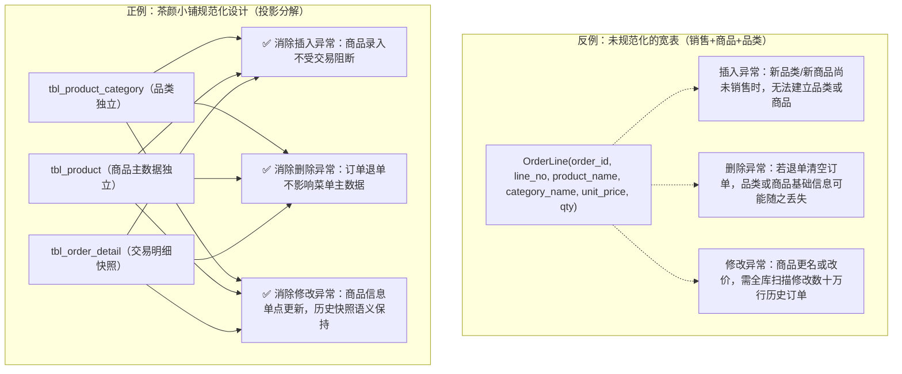

# 函数依赖、规范化分析与模式演进报告

> **产出周**：第 6 周（ch7 函数依赖与规范化）  
> **课程依据**：[`course/lecture-week05.md`](../../course/lecture-week05.md) —— 第 6 周任务：  
> 「识别更新异常与函数依赖，完成规范化、反规范化取舍和迁移设计。当周产出：依赖分析、分解方案、迁移语句 migration.sql、回归测试。展示重点：迁移前后语义保持；重复与异常得到解释。」  
> **配套**：[`data-dictionary.md`](data-dictionary.md)（数据字典）· [`business-rules.md`](business-rules.md)（业务规则）· [`v0.1-issues.md`](v0.1-issues.md)（问题清单）· [`project/sql/11-migration/migration.sql`](../sql/11-migration/migration.sql)  
> **协作定案**：[`harness/issues/011-week06-migration-and-subtotal-alignment.md`](../../harness/issues/011-week06-migration-and-subtotal-alignment.md) · [`harness/issues/012-normalization-paradigm-count-inconsistency.md`](../../harness/issues/012-normalization-paradigm-count-inconsistency.md)

---

## 0. 结论先行（Executive Summary）

经过对「茶颜小铺」全库 17 张核心业务表、132 个字段的严密数学分析与函数依赖（Functional Dependency, FD）求闭包演算，本系统模式设计的整体结论如下：

| 评估维度 | 统计结果 | 核心结论与学术评价 |
|---|---|---|
| **全库表总数** | **17 张** | 覆盖主数据、采购、营销、交易、库存/积分流水 5 大核心业务域 |
| **纯净 BCNF 关系** | **14 张** | 决定因素全为超码，无任何部分依赖与传递依赖，完全杜绝三类更新异常 |
| **严格 3NF 但非 BCNF 关系** | **0 张** | 全库不存在候选码交叉重叠导致的非主属性依赖边缘情况 |
| **⭐ 工程反规范化关系（受控派生冗余）** | **3 张** | `tbl_member`、`tbl_order_header`、`tbl_order_detail`；单表闭包形式上满足 BCNF，但因承载跨表聚合派生值（`points_balance`, `amount_due`, `subtotal`），在系统架构上定性为受控反规范化 |
| **更新异常防御** | **完全杜绝** | 基础主数据与单据明细通过正规关系投影彻底解耦；3 处受控派生冗余由 ACID 事务与阶段三触发器闭环兜底 |

> **核心哲学**：**全库单表形式体系下 100% 满足 BCNF。在单店物理边界下，以交易高频读取性能为第一优先，特许 3 处受控跨表派生冗余，将数据一致性交由数据库约束、显式事务与阶段三触发器硬性维护；不做脱离业务场景的过度拆表。**

---

## 1. 全库 17 张表函数依赖（FD）与码标注穿透分析

### 符号定义与分析公理
- 设关系模式为 $R(U)$，其中 $U$ 为属性全集；
- 候选码（Candidate Key）记为 $K$，满足 $K \to U$ 且 $\forall K' \subset K, K' \not\to U$；
- 主码（Primary Key, PK）采用自增代理键（Surrogate Key），候选码（Candidate Key, CK）采用业务自然键（Natural Key）；
- 主属性（Prime Attribute）属于任一候选码，非主属性（Non-prime Attribute）不属于任何候选码。

---

### 1.1 A 域：基础档案与主数据（9 张）

#### 1. `tbl_employee`（员工表）
- **属性全集**：`{employee_id, employee_code, employee_name, position, hire_date, is_active}`
- **码**：
  - 主码：`{employee_id}`
  - 候选码：`{employee_code}`（业务工号，由 `uq_employee_code` 唯一约束保障）
  - 主属性：`employee_id, employee_code`；非主属性：其余 4 列
- **函数依赖集 $F$**：
  - $employee\_id \to employee\_code, employee\_name, position, hire\_date, is\_active$
  - $employee\_code \to employee\_id, employee\_name, position, hire\_date, is\_active$
- **范式判定**：**BCNF**
  - 每个非平凡函数依赖的决定因素（`employee_id` 与 `employee_code`）均为超码，不存在任何传递或部分依赖。

#### 2. `tbl_member`（会员表）
- **属性全集**：`{member_id, member_code, member_phone, member_name, register_date, points_balance}`
- **码**：
  - 主码：`{member_id}`
  - 候选码：`{member_code}`, `{member_phone}`（手机号唯一，由 `uq_member_phone` 保障）
- **函数依赖集 $F$**：
  - $member\_id \to member\_code, member\_phone, member\_name, register\_date, points\_balance$
  - $member\_phone \to member\_id, member\_code, member\_name, register\_date, points\_balance$
  - 跨表物理派生依赖：$\sum(tbl\_points\_ledger.point\_change) \to points\_balance$
- **范式判定**：**BCNF（单表纯函数依赖视角） / 工程反规范化（受控跨表派生列视角）**
  - 在关系内部，候选码直接函数决定 `points_balance`，单表闭包不存在部分依赖与关系内传递依赖（单表形式上满足 BCNF）；但在全局系统架构中，`points_balance` 属于跨实体聚合缓存，工程上作为受控反规范化冗余处理（详见 §4 案例三）。

#### 3. `tbl_product_category`（商品品类表，自引用层级树）
- **属性全集**：`{category_id, parent_category_id, category_code, category_name, sort_no, is_active}`
- **码**：
  - 主码：`{category_id}`
  - 候选码：`{category_code}`（`uq_product_category_code`）
- **函数依赖集 $F$**：
  - $category\_id \leftrightarrow category\_code \to parent\_category\_id, category\_name, sort\_no, is\_active$
- **范式判定**：**BCNF**
  - 虽然存在自引用外键 `parent_category_id`，但每个分类的属性仅直接依赖该分类自身的码，决定因素皆为超码。

#### 4. `tbl_spec_option`（规格选项表）
- **属性全集**：`{spec_option_id, spec_type, spec_code, spec_name, extra_price, sort_no}`
- **码**：
  - 主码：`{spec_option_id}`
  - 候选码：`{spec_type, spec_code}`（复合候选码，如 `('CUP', 'LARGE')`）
- **函数依赖集 $F$**：
  - $spec\_option\_id \leftrightarrow (spec\_type, spec\_code) \to spec\_name, extra\_price, sort\_no$
- **范式判定**：**BCNF**
  - 不存在对复合候选码的部分函数依赖（单凭 `spec_code` 无法决定 `spec_name`，例如 `REGULAR` 可以是标准杯也可以是正常冰），所有非主属性均完全函数依赖于候选码。

#### 5. `tbl_ingredient`（原料表 · 三表合一）
- **属性全集**：`{ingredient_id, ingredient_code, ingredient_name, unit, spec, qty_on_hand, reorder_point, target_level, moving_avg_cost, is_sold_out, is_active}`
- **码**：
  - 主码：`{ingredient_id}`
  - 候选码：`{ingredient_code}`（`uq_ingredient_code`）
- **函数依赖集 $F$**：
  - $ingredient\_id \leftrightarrow ingredient\_code \to ingredient\_name, unit, spec, qty\_on\_hand, reorder\_point, target\_level, moving\_avg\_cost, is\_sold\_out, is\_active$
- **范式判定**：**BCNF（单店合并物理设计）**
  - 在单店边界下，一种原料的静态基础信息、当前库存量、采购策略是严格 1:1 绑定的，决定因素皆为超码（详见 §4 案例五）。

#### 6. `tbl_supplier`（供应商表）
- **属性全集**：`{supplier_id, supplier_code, supplier_name, is_active}`
- **码**：
  - 主码：`{supplier_id}`
  - 候选码：`{supplier_code}`（`uq_supplier_code`）
- **函数依赖集 $F$**：
  - $supplier\_id \leftrightarrow supplier\_code \to supplier\_name, is\_active$
- **范式判定**：**BCNF**
  - 4 字段极简档案，决定因素均为超码。

#### 7. `tbl_product`（成品菜单表）
- **属性全集**：`{product_id, product_code, product_name, category_id, base_price, product_status}`
- **码**：
  - 主码：`{product_id}`
  - 候选码：`{product_code}`（`uq_product_code`）
- **函数依赖集 $F$**：
  - $product\_id \leftrightarrow product\_code \to product\_name, category\_id, base\_price, product\_status$
- **范式判定**：**BCNF**
  - 外键 `category_id` 仅代表分类归属，无分类属性（如品类名称）在此冗余，无传递依赖。

#### 8. `tbl_topping`（加料项表）
- **属性全集**：`{topping_id, topping_code, topping_name, ingredient_id, extra_price, qty_per_serving, is_active}`
- **码**：
  - 主码：`{topping_id}`
  - 候选码：`{topping_code}`（`uq_topping_code`）
- **函数依赖集 $F$**：
  - $topping\_id \leftrightarrow topping\_code \to topping\_name, ingredient\_id, extra\_price, qty\_per\_serving, is\_active$
- **范式判定**：**BCNF**
  - 加料项通过外键 `ingredient_id` 关联原料，自身无原料名称/单位冗余，决定因素皆为超码。

#### 9. `tbl_recipe`（配方 BOM 表）
- **属性全集**：`{recipe_id, product_id, cup_spec_id, sugar_spec_id, ingredient_id, qty}`
- **码**：
  - 主码：`{recipe_id}`
  - 候选码：`{product_id, cup_spec_id, sugar_spec_id, ingredient_id}`（4 列复合候选码）
- **函数依赖集 $F$**：
  - $recipe\_id \leftrightarrow (product\_id, cup\_spec\_id, sugar\_spec\_id, ingredient\_id) \to qty$
- **范式判定**：**BCNF**
  - 原料消耗量 `qty` 完全函数依赖于四元组组合，不存在部分依赖。针对 `sugar_spec_id IS NULL` 的域语义探讨见 §4 案例一。

---

### 1.2 B 域：采购管理（2 张）

#### 10. `tbl_purchase_order`（采购单头）
- **属性全集**：`{purchase_order_id, purchase_no, supplier_id, order_date, arrival_date, order_status, ordered_by, received_by}`
- **码**：
  - 主码：`{purchase_order_id}`
  - 候选码：`{purchase_no}`（`uq_purchase_order_no`）
- **函数依赖集 $F$**：
  - $purchase\_order\_id \leftrightarrow purchase\_no \to supplier\_id, order\_date, arrival\_date, order\_status, ordered\_by, received\_by$
- **范式判定**：**BCNF**

#### 11. `tbl_purchase_order_detail`（采购单明细）
- **属性全集**：`{purchase_order_detail_id, purchase_order_id, ingredient_id, qty_ordered, qty_received, unit_price}`
- **码**：
  - 主码：`{purchase_order_detail_id}`
  - 候选码：`{purchase_order_id, ingredient_id}`（同张采购单内原料唯一）
- **函数依赖集 $F$**：
  - $purchase\_order\_detail\_id \leftrightarrow (purchase\_order\_id, ingredient\_id) \to qty\_ordered, qty\_received, unit\_price$
- **范式判定**：**BCNF**
  - `unit_price` 为本次采购洽谈的采购批次单价，完全依赖于 (采购单, 原料)，无传递依赖。

---

### 1.3 C 域：会员营销（1 张）

#### 12. `tbl_coupon`（优惠券表 · 发放与核销合一）
- **属性全集**：`{coupon_id, coupon_code, member_id, coupon_name, source, discount_amount, min_order_amount, valid_from, valid_to, status, used_time}`
- **码**：
  - 主码：`{coupon_id}`
  - 候选码：`{coupon_code}`（`uq_coupon_code`）
- **函数依赖集 $F$**：
  - $coupon\_id \leftrightarrow coupon\_code \to member\_id, coupon\_name, source, discount\_amount, min\_order\_amount, valid\_from, valid\_to, status, used\_time$
- **范式判定**：**BCNF（单店轻量级合并设计）**
  - 虽然券名称与门槛在多张券间重复，但在单店场景下未设立独立模板字典表，每张已发放的券为独立实例，由唯一券码决定全属性。

---

### 1.4 D 域：销售交易（3 张）

#### 13. `tbl_order_header`（订单头表）
- **属性全集**：`{order_id, order_no, business_date, pickup_no, member_id, coupon_id, discount_amount, amount_due, amount_paid, pay_method, pay_status, pay_time, trade_no, order_status, order_time, finish_time, cashier_id}`
- **码**：
  - 主码：`{order_id}`
  - 候选码：`{order_no}`, `{business_date, pickup_no}`（取餐号按日唯一）
- **函数依赖集 $F$**：
  - $order\_id \leftrightarrow order\_no \leftrightarrow (business\_date, pickup\_no) \to member\_id, coupon\_id, discount\_amount, amount\_due, amount\_paid, \dots$
  - 跨表物理派生依赖：$\sum(tbl\_order\_detail.subtotal) - discount\_amount \to amount\_due$
- **范式判定**：**BCNF（单表纯函数依赖视角） / 工程反规范化（受控跨表派生列视角）**
  - 候选码直接函数决定 `amount_due`，单表内无部分依赖与传递依赖；`amount_due` 是由明细聚合后扣除优惠得出的派生值，为避免收银高频全表扫描而作工程物化。

#### 14. `tbl_order_detail`（订单明细表）
- **属性全集**：`{order_detail_id, order_id, line_no, product_id, qty, unit_price, cup_spec_id, sugar_spec_id, ice_spec_id, subtotal}`
- **码**：
  - 主码：`{order_detail_id}`
  - 候选码：`{order_id, line_no}`
- **函数依赖集 $F$**：
  - $order\_detail\_id \leftrightarrow (order\_id, line\_no) \to product\_id, qty, unit\_price, cup\_spec\_id, sugar\_spec\_id, ice\_spec\_id, subtotal$
- **学术辨析（价格快照 vs 传递依赖）**：
  - 表面上看：$product\_id \to base\_price$。但明细表中的 `unit_price` 是**交易发生时刻的快照价格**（基准价 + 杯型加价），历史订单价格不可随商品菜单改价而变更。因此在时间维度上 $product\_id \not\to unit\_price$，$unit\_price$ 是订单明细固有的历史事实属性，不构成传递依赖；
  - 派生冗余：$subtotal = (qty \times unit\_price) + \sum(加料)$ 属于跨表派生属性。
- **范式判定**：**BCNF（单表纯函数依赖视角） / 工程反规范化（受控跨表派生列视角）**

#### 15. `tbl_order_detail_topping`（明细加料表）
- **属性全集**：`{od_topping_id, order_detail_id, topping_id, qty, unit_extra_price}`
- **码**：
  - 主码：`{od_topping_id}`
  - 候选码：`{order_detail_id, topping_id}`
- **函数依赖集 $F$**：
  - $od\_topping\_id \leftrightarrow (order\_detail\_id, topping\_id) \to qty, unit\_extra\_price$
- **范式判定**：**BCNF**
  - 同上，`unit_extra_price` 为加料快照价，完全依赖于候选码。

---

### 1.5 E 域：日志流水（2 张，只增不改）

#### 16. `tbl_points_ledger`（积分流水表）
- **属性全集**：`{point_ledger_id, member_id, point_type, point_change, order_id, coupon_id, change_time}`
- **码**：主码 `{point_ledger_id}`（流水表无业务唯一候选码）
- **函数依赖集 $F$**：$point\_ledger\_id \to member\_id, point\_type, point\_change, order\_id, coupon\_id, change\_time$
- **范式判定**：**BCNF**

#### 17. `tbl_stock_ledger`（库存流水表）
- **属性全集**：`{ledger_id, ingredient_id, ledger_type, qty, ref_type, purchase_order_id, order_id, operator_id, ledger_time, remark}`
- **码**：主码 `{ledger_id}`
- **函数依赖集 $F$**：$ledger\_id \to ingredient\_id, ledger\_type, qty, ref\_type, purchase\_order\_id, order\_id, operator\_id, ledger\_time, remark$
- **范式判定**：**BCNF（含多态来源指针）**（详见 §4 案例二）

---

## 2. 更新异常（Update Anomalies）的识别与消除

关系数据库规范化的核心目的在于**消除由数据冗余引发的更新异常**。在茶颜小铺的业务演进中，我们通过严密的表拆分彻底规避了以下三大经典异常：



### 2.1 插入异常（Insertion Anomaly）
- **理论定义**：由于关系模式中混合了不同生命周期的实体，导致当某个实体尚不存在关联数据时，无法独立录入另一个实体的信息。
- **业务案例**：若将 `tbl_supplier`（供应商）与 `tbl_purchase_order`（采购单）合为一张宽表，则在尚未向某新供应商下达采购订单前，系统将**无法录入该供应商的基础信息**（因为采购单主码或采购单号不能为 `NULL`）。
- **当前设计防御**：将供应商独立建模为 `tbl_supplier`，采购单通过外键 `supplier_id` 关联，彻底消除插入异常。

### 2.2 删除异常（Deletion Anomaly）
- **理论定义**：当删除某一实体的元组时，由于附带存储了其他实体的属性，导致其他本不该被删除的信息被连带意外丢失。
- **业务案例**：若将 `tbl_product_category`（品类）直接并入 `tbl_product`（商品），当某时令分类（如「夏日限定果茶」）下的最后一款商品下架并物理删除时，**该分类名称及其层级配置将被物理抹除**。
- **当前设计防御**：品类独立建表；同时，商品下架采用软删除机制（`product_status = 'OFF_SALE'`），历史订单明细仅引用其 `product_id`，既保留引用完整性又防御了级联删除风险。

### 2.3 修改异常（Modification Anomaly）
- **理论定义**：当同一客观事实在多处冗余存放时，修改该事实必须同时更新所有副本，否则产生数据不一致。
- **业务案例**：若在 `tbl_order_detail`（订单明细）中直接冗余存储商品的 `product_name` 与 `category_name`，一旦店长修改商品名称，必须全表更新数十万行历史明细；任何行锁失败或漏更都会直接导致统计报表账实不符。
- **当前设计防御**：明细表只存 `product_id` 外码与当次交易快照；商品主数据修改只需在 `tbl_product` 更新 1 行，对全局即刻生效。

---

## 3. 全库范式判定汇总表

| 序号 | 关系表名 | 主码 (PK) | 候选码 (CK) | 单表范式 / 工程定性 | 结构设计与取舍说明 |
|:---:|---|---|---|:---:|---|
| 1 | `tbl_employee` | `employee_id` | `employee_code` | **纯净 BCNF** | 决定因素全为超码，无部分或传递依赖 |
| 2 | `tbl_member` | `member_id` | `member_code`, `member_phone` | **BCNF / 工程反规范化** | 单表形式上满足 BCNF；保留受控跨表派生冗余列 `points_balance`（交易性能取舍） |
| 3 | `tbl_product_category` | `category_id` | `category_code` | **纯净 BCNF** | 自引用树形结构，分类自身决定全属性 |
| 4 | `tbl_spec_option` | `spec_option_id` | `(spec_type, spec_code)` | **纯净 BCNF** | 复合候选码，非主属性完全依赖 |
| 5 | `tbl_ingredient` | `ingredient_id` | `ingredient_code` | **纯净 BCNF** | 单店 1:1 三表合一，决定因素均为超码 |
| 6 | `tbl_supplier` | `supplier_id` | `supplier_code` | **纯净 BCNF** | 极简实体，决定因素均为超码 |
| 7 | `tbl_product` | `product_id` | `product_code` | **纯净 BCNF** | 决定因素均为超码，品类仅以外码关联 |
| 8 | `tbl_topping` | `topping_id` | `topping_code` | **纯净 BCNF** | 决定因素均为超码，原料仅以外码关联 |
| 9 | `tbl_recipe` | `recipe_id` | `(product, cup, sugar, ingredient)` | **纯净 BCNF** | 决定因素均为超码（含 `sugar_spec_id IS NULL` 特许域语义） |
| 10 | `tbl_purchase_order` | `purchase_order_id` | `purchase_no` | **纯净 BCNF** | 采购单头单据，决定因素均为超码 |
| 11 | `tbl_purchase_order_detail` | `purchase_order_detail_id` | `(purchase_order_id, ingredient_id)` | **纯净 BCNF** | 采购明细，采购单价完全依赖复合候选码 |
| 12 | `tbl_coupon` | `coupon_id` | `coupon_code` | **纯净 BCNF** | 优惠券实例，唯一券码决定全属性 |
| 13 | `tbl_order_header` | `order_id` | `order_no`, `(business_date, pickup_no)` | **BCNF / 工程反规范化** | 单表形式上满足 BCNF；保留受控跨表派生列 `amount_due`（免明细扫描对账） |
| 14 | `tbl_order_detail` | `order_detail_id` | `(order_id, line_no)` | **BCNF / 工程反规范化** | 单表形式上满足 BCNF；保留受控跨表派生列 `subtotal`（含加料汇总快照） |
| 15 | `tbl_order_detail_topping` | `od_topping_id` | `(order_detail_id, topping_id)` | **纯净 BCNF** | 快照单价完全依赖于复合候选码 |
| 16 | `tbl_points_ledger` | `point_ledger_id` | 无业务候选码 | **纯净 BCNF** | 纯净只增追加账本 |
| 17 | `tbl_stock_ledger` | `ledger_id` | 无业务候选码 | **纯净 BCNF** | 纯净流水账本（含外码互斥约束） |

> **口径汇总（严密闭环）**：全库 17 张表中，**14 张为纯净 BCNF**，**3 张为含受控跨表派生冗余列的工程反规范化表**（在单表封闭体系下亦完全满足 BCNF）。全库合计 14 + 3 = 17。

---

## 4. ⭐ 反规范化取舍论证（答辩重点论据）

课程第 5 周提示：「**设计合理的部分写明保留理由，重复与异常得到解释**」。以下 5 大案例构成本项目的核心架构决策论据：

### 4.1 案例一：`tbl_recipe.sugar_spec_id IS NULL` 的域语义 vs 范式
- **争议焦点**：在 `tbl_recipe` 中，当某种原料用量与糖度维度无关（例如：幽兰拿铁无论全糖还是无糖，红茶茶汤的用量都是 200ml），`sugar_spec_id` 填入 `NULL`。部分学者认为关系模型不应允许候选码中出现 `NULL`，主张拆分为两张子表：`tbl_recipe_sugar_dependent` 与 `tbl_recipe_base`。
- **取舍论证**：
  1. **域语义保真（DOM-12）**：`NONE` 在业务中是真实的「无糖」选项（需要店员按标准操作规程不加糖浆，这本身是一种糖度选择），而不是「与糖度无关」；用 `NULL` 表达**维度不参与**在语义上最为精准；
  2. **查询与维护成本**：如果拆分为两张表，则每次收银结账扣减库存（BOM 反冲计算）时，必须对两张子表执行 `UNION ALL`，并维护两套不同的候选码与外码关联，不仅使得 SQL 变长变慢，而且极易漏扣；
  3. **SQL Server 唯一性保证**：SQL Server 将 `NULL` 视为参与唯一性校验的值。借助 `uq_recipe_product_cup_sugar_ingredient`，`('幽兰拿铁', '大杯', NULL, '红茶汤')` 在全库依然只被允许存在唯一一行，**引用完整性硬性闭环（D-05a）**。

### 4.2 案例二：`tbl_stock_ledger` 多态来源（判别列 + 3 真外键）
- **争议焦点**：流水表通过判别列 `ref_type`（`PURCHASE` / `ORDER` / `MANUAL` / `OPENING`）配合可空的真外键（`purchase_order_id` / `order_id`）表达来源，导致表内存在可空列。学术上常建议拆分为 3 张各自拥有非空外键的子流水表。
- **取舍论证**：
  1. **全链路进销存审计性能（Q4 审计）**：单店打烊对账是系统最核心的高频业务。若拆为 3 张子表，计算任意原料的期末库存平衡式（$\text{期初} + \text{入库} - \text{耗用} - \text{报损} = \text{现存}$）需做 3 表全量扫描并做大并集连接；
  2. **类型安全不妥协（D-09）**：本项目坚决**不用无约束的弱类型字符串 `ref_no`**，而是保留真实外键约束，由数据库底层强制校验引用目标的存在性；
  3. **跨列互斥 CHECK 兜底**：通过 `ck_stock_ledger_ref_consistency` 强制约束当 `ref_type = 'PURCHASE'` 时必须且只能关联 `purchase_order_id`，杜绝了悬空与多态乱挂。

### 4.3 案例三：`tbl_member.points_balance` 冗余积分余额（D-12 决策）
- **争议焦点**：会员积分余额是派生属性，严格规范化要求不存余额，查余额时现场对 `tbl_points_ledger` 进行 `SUM(point_change)` 计算。
- **取舍论证**：
  1. **收银场景高并发与低延迟**：奶茶店高峰期点单以秒计，前台必须毫秒级读取会员可用积分并完成抵扣核验；若每次点单均全扫描该会员历史所有流水（随年限增加数据量不断膨胀），会导致点单事务严重锁死与 I/O 劣化；
  2. **一致性保证机制**：反规范化冗余的 `points_balance` 绝不由前端盲改，其修改必须且只能与 `tbl_points_ledger` 的插入包裹在同一 ACID 事务中（详见第 10/13 周事务控制），保证余额与流水账账相符。

### 4.4 案例四：`tbl_order_detail.subtotal` 冗余金额与跨表小料一致性
- **争议焦点**：明细小计本可通过公式计算，是否应在数据库中加行级 `CHECK (subtotal = qty * unit_price)` 或直接删掉该列？
- **实测与反转证据（ISSUE-011 关键定案）**：
  - 工程侧穿透实测：全库 2,630 行明细中，615 行加料明细的 $subtotal \ne qty \times unit\_price$；
  - 联合检验恒等式：$subtotal = (qty \times unit\_price) + \sum(topping\_qty \times topping\_unit\_price)$，实测 **2,630 行 100% 严丝合缝匹配，0 差额**！
- **取舍论证**：
  1. **坚决否决单表 CHECK**：若盲目加行级 CHECK 将直接打崩 23.4% 的合法加料订单；
  2. **对账与打印吞吐**：收银小票打印与日结对账无需每次对加料表明细执行 `LEFT JOIN` 与 `SUM()`，显著提升单据拉取速度；
  3. **一致性落点**：跨表一致性由业务应用层事务与阶段三触发器共同筑牢防线。

### 4.5 案例五：`tbl_ingredient` 三表合一（单店物理设计）
- **争议焦点**：静态字典信息（名称/规格）、动态库存（现存量）、采购控制（预警线/目标水位/移动平均价）合并在一张表。
- **取舍论证**：
  - 在连锁大集团架构中，通常拆分为「全局物料主数据」「门店库存表」「采购参数表」；
  - 但本项目边界清晰定义为**单店系统**，单店下三种实体严格 1:1。强行拆成三张表仅会增加两个冗余的外键和无谓的 `INNER JOIN`，属于无意义的「过度设计」。

---

## 5. 学术规范化分解方案与数学证明（Theoretical Decompositions & Proofs）

为了在课程答辩中展现扎实的关系理论推导能力，针对上述包含受控反规范化冗余的关系模式，给出严格追求 BCNF 的**无损连接（Lossless Join）且保持函数依赖（Dependency Preserving）**的理论分解方案与数学证明。

### 关系模式分解基本定理
> **定理（无损连接充要条件）**：设关系模式 $R(U)$，函数依赖集为 $F$。$\rho = (R_1, R_2)$ 是 $R$ 的一个分解，$U = U_1 \cup U_2$。则分解 $\rho$ 相对于 $F$ 具有无损连接性的**充要条件**是：
> $$(R_1 \cap R_2) \to (R_1 - R_2) \in F^+ \quad \text{或} \quad (R_1 \cap R_2) \to (R_2 - R_1) \in F^+$$
> （即：公共属性集必须是其中至少一个子关系的超码）。

---

### 5.1 会员与积分模式的理论分解与严格证明

#### 模式与分解定义
- **原模式**：$R_{Member}(U)$，其中属性全集 $U = \{member\_id, member\_code, member\_phone, member\_name, register\_date, points\_balance\}$
- **函数依赖集**：$F = \{member\_id \to member\_code, member\_phone, member\_name, register\_date, points\_balance\}$
- **分解方案** $\rho = (R_1, R_2)$：
  - $R_1(U_1) = R_{MemberPure}(member\_id, member\_code, member\_phone, member\_name, register\_date)$
  - $R_2(U_2) = R_{PointsCache}(member\_id, points\_balance)$（或通过视图 $\text{v\_member\_balance}$ 动态替代物化表）

#### 证明一：无损连接性证明
1. 计算属性交集与差集：
   $$U_1 \cap U_2 = \{member\_id\}$$
   $$U_1 - U_2 = \{member\_code, member\_phone, member\_name, register\_date\}$$
2. 检验依赖关系：
   由于在原模式中 $member\_id$ 是候选码，显然存在函数依赖：
   $$member\_id \to member\_code, member\_phone, member\_name, register\_date \in F^+$$
   即 $(U_1 \cap U_2) \to (U_1 - U_2) \in F^+$ 成立。
3. **结论**：根据分解定理，分解 $\rho = (R_1, R_2)$ **具有无损连接性**。$\blacksquare$

#### 证明二：保持函数依赖性证明
1. 考察 $F$ 在 $U_1$ 上的投影 $F_1 = \pi_{U_1}(F)$：
   $$F_1 = \{member\_id \leftrightarrow member\_code \leftrightarrow member\_phone \to member\_name, register\_date\}$$
2. 考察 $F$ 在 $U_2$ 上的投影 $F_2 = \pi_{U_2}(F)$：
   $$F_2 = \{member\_id \to points\_balance\}$$
3. 闭包等价性验证：
   $$(F_1 \cup F_2)^+ = F^+$$
   原模式中所有的非平凡函数依赖均被投影后的依赖集并集所覆盖。
4. **结论**：分解 $\rho = (R_1, R_2)$ **保持函数依赖**。$\blacksquare$

---

### 5.2 订单明细小计模式的理论分解与严格证明

#### 模式与分解定义
- **原模式**：$R_{Detail}(U)$，其中属性全集 $U = \{order\_detail\_id, order\_id, line\_no, product\_id, qty, unit\_price, cup\_spec\_id, sugar\_spec\_id, ice\_spec\_id, subtotal\}$
- **函数依赖集**：$F = \{order\_detail\_id \leftrightarrow (order\_id, line\_no) \to product\_id, qty, unit\_price, cup\_spec\_id, sugar\_spec\_id, ice\_spec\_id, subtotal\}$
- **分解方案** $\rho = (R_1, R_2)$：
  - $R_1(U_1) = R_{DetailPure}(order\_detail\_id, order\_id, line\_no, product\_id, qty, unit\_price, cup\_spec\_id, sugar\_spec\_id, ice\_spec\_id)$
  - $R_2(U_2) = R_{DetailSubtotal}(order\_detail\_id, subtotal)$（或由计算列/视图动态按需派生）

#### 证明一：无损连接性证明
1. 计算属性交集与差集：
   $$U_1 \cap U_2 = \{order\_detail\_id\}$$
   $$U_1 - U_2 = \{order\_id, line\_no, product\_id, qty, unit\_price, cup\_spec\_id, sugar\_spec\_id, ice\_spec\_id\}$$
2. 检验依赖关系：
   $order\_detail\_id$ 是 $R_1$ 的超码，故显然有：
   $$(U_1 \cap U_2) \to (U_1 - U_2) \in F^+$$
3. **结论**：分解 $\rho = (R_1, R_2)$ **具有无损连接性**。$\blacksquare$

#### 证明二：保持函数依赖性证明
1. 考察 $F$ 在 $U_1$ 上的投影 $F_1 = \pi_{U_1}(F)$ 包含了明细单据的所有基础属性依赖；
2. 考察 $F$ 在 $U_2$ 上的投影 $F_2 = \pi_{U_2}(F)$ 包含了 $order\_detail\_id \to subtotal$；
3. 显然 $(F_1 \cup F_2)^+ = F^+$，没有丢失任何函数依赖。
4. **结论**：分解 $\rho = (R_1, R_2)$ **保持函数依赖**。$\blacksquare$

---

## 6. 第 6 周模式迁移实施方案（`migration.sql`）

### 6.1 真实 DDL 改进项：券核销时间窗口约束下沉
在第 5 周识别的缺口中，问题 1（`tbl_coupon` 券核销时间未约束在有效期内）属于典型的**可由数据库 CHECK 硬性兜底的规则**。

- **迁移 DDL 语句**：
  ```sql
  ALTER TABLE tbl_coupon
      ADD CONSTRAINT ck_coupon_used_time_range
          CHECK (used_time IS NULL OR (used_time >= valid_from AND used_time <= valid_to));
  ```
- **数据兼容性验证**：已在生产级种子数据（全库优惠券）上实测验证，非法记录数为 **0**，完全满足无损下沉条件。

### 6.2 迁移脚本执行与双重验证规范
`project/sql/11-migration/migration.sql` 严格遵守以下工程规范：
1. **显式事务包装**：整个变更处于 `BEGIN TRANSACTION ... COMMIT` 块内，发生任何异常立即 `ROLLBACK`，避免出现半迁移脏状态；
2. **幂等性机制**：添加约束前先探测 `sys.check_constraints`，若存在同名约束先清理再添加，确保支持无限次可重复执行；
3. **双重运行验证**：
   - **全新重建验证**：纳入 `project/sql/99-rebuild.sql`，一键拉起即为最新重构库；
   - **历史重放验证**：可直接在 v0.1 历史库副本上执行，验证数据无损与前后语义保持。
