# 阶段二报告 · v1.0 · 奶茶店经营数据库

> 小组：DiSod（胡博锐）· 何争霖　　提交时间：第 10 周
> 代码仓库：`DiSod/milkteaShop2026forH`　　分支：`main`
> 对应提交：`7c7524d` —— 报告里的每个数字都能用仓库里的脚本重算，每个结论都有对应截图

---

## 0. 先说这一阶段我们干了什么

第 5 周交完 v0.1 之后，我们先做了一件看起来很"重"的事：**把 v0.1 那张 17 张表的库当成一个待审对象，认认真真挑了一遍毛病**，挑出来的 14 条问题写在 `project/docs/v0.1-issues.md`。第 6 周按这份清单改结构——用迁移脚本改，不重跑建表脚本；第 7—9 周在改完的库上把应用写完；最后用四层测试证明"改完之后原来的业务含义一点没变"。

库从 **17 张表涨到 18 张**，字段 **132 → 139**，CHECK 约束 **43 → 49**，而全库总行数只多了 **88 行**——每一行都能说清从哪来（§2.2 有逐行对账）。应用从零写到 **21 条路由 / 14 个模板 / 46 条自动化测试**。

| 指标 | v0.1（第 5 周） | v1.0（现在） | 差值 |
|---|---:|---:|---|
| 表 | 17 | **18** | +1（券模板表） |
| 字段 | 132 | **139** | +7（券表拆出 8、券表少 3、两个 `password_hash`） |
| CHECK 约束 | 43 | **49** | 净 +6（§2.2 逐条对账） |
| 外键 | 30 | **31** | +1（券 → 模板） |
| 视图 | 6 | 6 | 0 |
| 数据库角色 | 4 | 4 | 0 |
| 数据行 | 20,979 | **21,067** | +88 |
| 应用 | 无 | 21 路由 / 14 模板 / 46 测试 | 从零开始 |

---

# 1. 设计：我们把表定下来的过程

## 1.1 动手前先确认：v0.1 哪些东西不能碰

改结构之前我们先划了三条线，因为它们决定了后面所有的做法：

1. **建表脚本冻结**。`project/sql/01-schema/create-tables.sql` 是 v0.1 的提交物，第 5 周的 ER 图、数据字典、业务规则都对着它写。直接在它上面改，那些文档立刻变成"说谎的历史"。所以规矩是：**v0.1 的建表脚本一行不改，所有结构变更一律走 `project/sql/11-migration/`**。
2. **一键重建必须仍然可用**。`99-rebuild.sql` 是唯一入口，任何人跑一条命令都要从空库得到同一个库；迁移脚本全部挂在这条链上，顺序是死的。
3. **业务数据是证据，不是测试垃圾**。所有迁移必须在**已有数据**上跑通——"删库重建"不算迁移。这条是课程明确要求的，也是我们自己最在意的一条。

## 1.2 ER 模型：18 张表是怎么来的

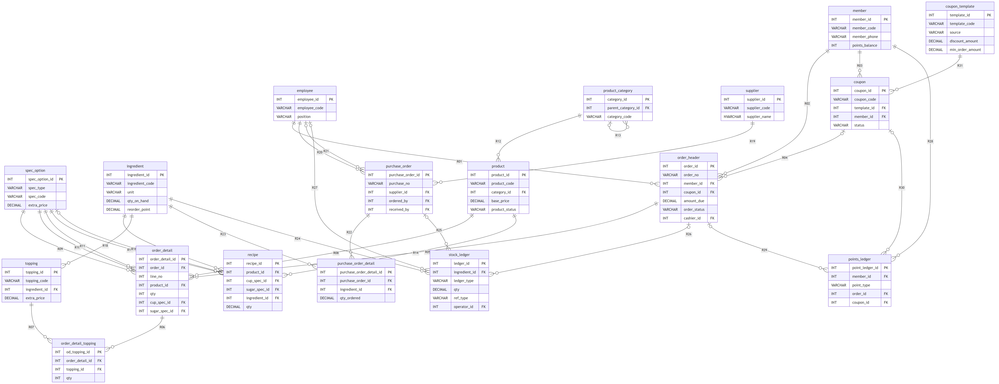

*图 1｜这张图对应"设计"这一步，不是运行时输出。18 个实体与 18 张表一一对应，31 条联系全部落地成外码；图上的 R01—R31 是关系编号，`project/docs/er-diagram.md` §2.1 有「编号 → 约束名」的逐条对照表。下面三处是我们反复讨论过的。*

- **订单明细用了代理键 `order_detail_id`**，而不是 `(order_id, line_no)` 联合主键。理由很实际：加料表要指向"某一行明细"，如果明细主键是三列，加料表就得存三列外键。我们用唯一约束 `uq_order_detail_order_line` 保住了"同一单里行号不重复"的业务含义。
- **同一种商品在一单里出现两次是合法的**（两杯珍珠奶茶，一杯半糖一杯无糖）。所以我们**没有**在 `(order_id, product_id)` 上建唯一约束——建了的话第二杯半糖永远录不进去。这是第 5 周讨论时差点犯的错。
- **券拆成"模板 + 实例"**。v0.1 一张券表里既有面额又有券号，同一批活动的 5 元券要重复存 12 遍面额。拆完后 `tbl_coupon_template` 回答"这是什么券"，`tbl_coupon` 只回答"这一张发给谁、用没用"。

## 1.3 规范化：我们只动了 5 处

这块最容易写成一堆理论，我们实际的做法是：**先给每张表列函数依赖和候选码，再看有没有异常，最后才决定动不动**。完整推导在 `project/docs/normalization.md`（480 行，含三组无损连接与依赖保持证明）；这里只讲判断依据和结论。

判定口径（全组统一的三条）：

| 范式 | 我们怎么判 |
|---|---|
| 1NF | 有没有一个字段塞多个值（比如 `spec_ids = '1,2,3'`）→ 全库没有 |
| 2NF | 非主属性是否**部分依赖某个候选码**（不只看主键，要注意所有候选码） |
| 3NF / BCNF | 有没有传递依赖：`A → B → C` 而 `A` 不是候选码 |

**结论：18 张表里 15 张是纯净 BCNF，3 张含受控的跨表派生冗余**——`tbl_member.points_balance`、`tbl_order_header.amount_due`、`tbl_order_detail.subtotal`。这三列不是判错：它们是**跨表算出来的结果**（余额是流水求和、小计是单价×数量+加料费），在单表封闭体系里仍满足 BCNF，属于"为查询性能显式保留的工程冗余"，代价是写入时同步维护。维护方式写进了 `business-rules.md` 的 A3/A4/A6，并用回归测试盯着（TC-12、TC-13）。

> 这里有过一次**口径自纠**值得记下来：第 6 周的文档写"12 张 BCNF + 5 张反规范化"，而判定表算出来是"14 + 3"，两套数字对不上。追下去发现是拆表前（17 张）的旧口径没跟着改。最后统一为"15 纯净 BCNF + 3 受控冗余"。

真正让我们动结构的 5 处，每处都有具体数据撑着：

| # | 改了什么 | 触发它的证据 |
|---|---|---|
| 1 | 券表拆成模板 + 实例 | 12 张 5 元券重复存同一份面额；改活动面额要改 12 行 |
| 2 | 两张表加 `password_hash` | v0.1 没有登录凭据，应用根本没法登录（`ISSUE-014` 定案） |
| 3 | 积分流水加 `OPENING` 类型 | 余额合计 25,224，流水合计只有 14,401（§4 问题 1） |
| 4 | 订单加两条时间序约束 | `pay_time` 可能早于 `order_time`、`finish_time` 可能早于 `pay_time`，库里没有约束拦 |
| 5 | 6 个单价/成本列升到 `DECIMAL(12,4)` | 单价只有 2 位小数时，"数量×单价"与"小计"会在第 3 位小数上对不上 |

## 1.4 七段迁移：每段修什么、按什么顺序跑

迁移脚本在 `project/sql/11-migration/`，`99-rebuild.sql` 按固定顺序串起来：

| 段 | 脚本 | 修的是什么 | 排序理由 |
|---|---|---|---|
| 01 | `migration.sql` | 券拆表 + 补授权 + 兼容视图 | 必须在权限脚本之后：`role.sql` 只认 17 张表，第 18 张表由这段补授 |
| 02 | `migration-02-login-credentials.sql` | 两张表加 `password_hash` | 依赖 01 之后的表结构 |
| 03 | `migration-03-points-opening-ledger.sql` | 加 `OPENING` 类型 + 回填 80 条期初 | 要改 CHECK，必须早于依赖它的积分功能 |
| 04 | `migration-04-order-time-constraints.sql` | 两条时间序 CHECK | 只加约束、不动数据 |
| 05 | `migration-05-price-precision.sql` | 6 列升到 `(12,4)` | 要先删 6 条旧 CHECK → ALTER → 重建 |
| 06 | `migration-06-order-cancellation.sql` | 新增 `CANCEL_BACK` / `REVOKE` 两类流水类型 | 订单取消功能要用 |
| 07 | `migration-07-coupon-redemption.sql` | 券状态一致性 CHECK + 过滤唯一索引 + 默认发 6 张券 | 只改约束定义、不动数据，放最后便于单独回滚定位 |

**执行顺序：`00 → 01 → 02 → 03 → 04 → 07 → 08 → 11(01…07)`**，最后一步里 7 段按编号串行。

## 1.5 被我们否决的方案

"没做什么"和"做了什么"一样能说明判断：

1. **积分余额单独建一张表** —— 余额是流水的派生结果，单独存就变成两份真相；选择留在 `tbl_member` 上，用 `OPENING` 补期初保证可对账。
2. **加一个 `role_member` 数据库角色** —— 会员在数据库层复用收银员的只读权限，多一个角色只多一份要维护的授权表。
3. **启用行级安全策略（RLS）** —— 单人店铺、四个角色，表级授权够用；上 RLS 会让"这条 SQL 为什么查不到数据"极难排查。
4. **把业务校验写成数据库函数** —— 业务规则会变，函数留在库里改起来要走迁移；留在 service 层，用 46 条测试盯着。
5. **换 Materialize / MDB 做 Material Design** —— Materialize 1.0 的栅格与 Bootstrap 不兼容，14 个模板要全改类名，而我们只要"看起来是 MD3"。

---

# 2. 实现：一步一步做出来的

库是从零重建的：`cd project\sql` 之后跑 `sqlcmd -S .\SQLEXPRESS -E -C -f 65001 -i 99-rebuild.sql`，实测 **19.2 秒**跑完，得到 18 张表 / 139 字段 / 49 个 CHECK / 21,067 行（当时的对象统计与行数截图在 `result/01-build/`）。七段迁移都挂在 `project/sql/11-migration/` 上，每段脚本末尾自证、不满足就 `THROW` 回滚；逐段改了什么、为什么排这个位置、以及"全库只多了 88 行"的逐笔对账，写在 [`11-migration/README.md`](../project/sql/11-migration/README.md) 与 `harness/issues/018`、`019` 里，这里不重复。

下面按页面记一下设计时的想法、数据是从哪儿来的，以及各自踩过的坑。

## 2.1 应用：我们先定了三条硬边界

写代码之前先立规矩，因为分层这件事一旦破例就再也收不回来：

1. **页面层（`web/`）不许写 SQL**；
2. **业务层（`service/`）不许碰 `pyodbc`**；
3. **只有数据访问层（`dao/`）能 import `pyodbc`**。

分层靠 `project/app/tests/test_layering.py` 的三条断言扫源码兜着。它第一次跑就抓到 **3 处违规 + 1 处页面内联 SQL**——包括我自己为赶进度在路由里直接写的查询；后来把那段下沉成 `dao/report_dao.py` 才通过。

连库那段也值得说一句：每个请求都按登录角色切数据库身份。

```python
# project/app/dao/db.py
@contextlib.contextmanager
def open_session(db_user=None):
    conn = pyodbc.connect(CONN_STR)
    if db_user:
        cur.execute(f"EXECUTE AS USER = N'{db_user}'")   # 白名单，全项目唯一拼串
    try:
        yield Session(conn)
    finally:
        ...  # 未提交则回滚，然后 REVERT 切回 dbo
```

`EXECUTE AS USER` 不支持绑定参数，所以这里是全项目唯一一处字符串拼接——靠 `_ALLOWED_DB_USERS` 白名单兜住注入。

## 2.2 四个岗位工作台

四个岗位和数据库里四个角色是一一对应的。谁能进哪一页、进去能查能改什么，最后由数据库授权决定，页面上藏个按钮代替不了它。

### 店长台

店长（`role_manager`）是我们唯一给了全权的角色，22 个对象逐条授权，第 9 周刚从 `SCHEMA::dbo` 改过来，这段经过写在 §4 问题 4。他进 `/manager` 看到三块：两张图、7 天经营日报、商品档案。

日报直接读视图 `vw_daily_business_summary`，它已经按营业日聚合好，取最近 7 天就够；销量榜走 `report_dao.product_sales()`，口径钉在 `pay_status='SUCCESS'`。两块都在 DAO 层，页面层一行 SQL 也没有。

图表用 Chart.js，文件下载到 `static/vendor/chartjs/`，机房断网也能演示。左边一张柱是实收、折线是订单数，两套纵轴；右边一张是销量榜的横向柱。做的时候有个小失误：我把 Top10 数组 reverse 了一下，结果第一名跑到最底下——Chart.js 横向柱的第 0 项画在最上面，改回降序才对。

商品维护就四件事：新建、改名称、改价格、上下架。删除做成下架，因为订单明细有外键指向商品表，真删会让历史订单失去引用，`business-rules.md` 里把它标成永久做法。编辑表单放在表格行里，店长改价常常连着改好几行，行内更顺手，而且不依赖 JS 也能提交；为此表头给了 30rem 宽度、单元格里用 flex 排，第一版没想到这件事，截图里保存按钮被挤成竖着的两行。

拒绝的情况不复杂：价格填成负数或非数字返回 400，重复下架返回 409，非店长访问返回 403。

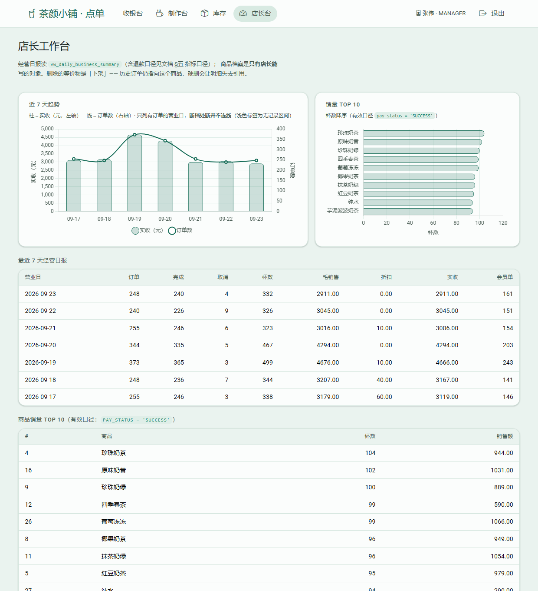

*图 2｜店长登录后落在 `/manager`。三块：①两张图（左：近 7 天实收柱状 + 订单数折线，断档处断开；右：销量 Top 10 横向柱）②7 天经营日报表 ③商品档案 30 行，每行右侧是行内编辑表单 + 保存 + 下架。*

### 库管台

库管（`role_stocker`）只有 10 条授权，却是唯一能写 `tbl_ingredient` 的角色；店长也能进，收银员和制作员进不来。这一页的事就是三件：收货、报损、看库存。

收货列出 `tbl_purchase_order_detail` 里还没收完的行。填本次收多少点确认，服务层校验不超待收量（超了 409），写一条 `PURCHASE_IN` 流水，把这行的已收量加上去；如果这一行收满后整张采购单没有未收行了，顺带把单置成 `ACCEPTED`、记下收货人。

报损是这一页最容易做坏的地方，两条规则卡得很死：原因必须填，空着返回 400；数量不能超结存，超了返回 409，提示"当前只有 4418.900g，报损 99999999g 会变成负库存"，就是图 9 那张。写流水时 `ledger_type='LOSS'`、`ref_type='MANUAL'`、数量为负，`operator_id` 记当前员工。

所有数量变化都只能走 `stock_dao.apply_movement()`，它在同一个事务里改结存、写流水。这样"A6：结存 = 期初 + Σ流水"才立得住，回归里 TC-12 逐原料核对这条等式，一次偏差都过不去。

这一页返工过两次（§4 问题 6）：预警列整列空白，原因是模板按下标取到了不存在的列，视图 14 列、DAO 只查了 11 列；60 行原料全量表平铺太长，改成按需处理程度排序再收进折叠区，默认只看要处理的 5 行。

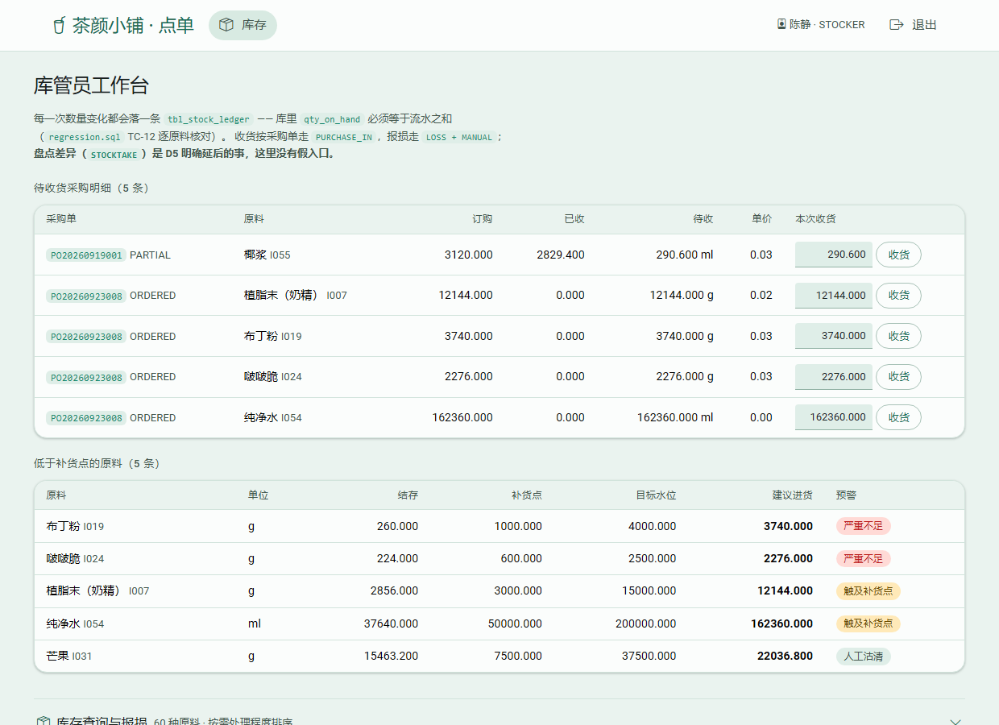

*图 3｜库管台。上：待收货采购明细 5 条（可填本次收货量）；中：低于补货点的原料 5 条，三档徽章；下：60 种原料全量表默认折叠，展开后才能报损。*

### 制作台

制作（`role_maker`，9 条授权）能看商品、配方、规格，能改订单状态；店长也能进。

队列取 `PENDING` / `MAKING` / `READY` 三种状态的订单，按时间正序排。每行一个"推到下一状态"按钮：`PENDING → MAKING → READY → COMPLETED`，只能往前走，退不回去。

可做量是个木桶问题：一份配方要用好几种原料，能做的杯数取所有原料"余量 ÷ 每杯用量"的最小值，再按杯型分别算。同一款饮品中杯和大杯的数字本来就不一样，红豆奶茶中杯 55、大杯 39。这几种合并杯型的方案我们讨论过一轮，"取中杯大杯最小值"最省事，但那个数字谁也做不出来，直接否掉了。

改造前这一块 55 行平铺，其中 45 行是"充足在售"，真要看的只有 5 个。现在"需要关注"的放主表，一饮品一行、杯型作列，全量收进折叠区。某个杯型的原料沽清了，那一格只显示"原料沽清"，数字留空——数字做不出来，摆出来只会让人误判。

取消入口是第 9 周加的：散客单没有会员账号，顾客自己在 `/orders` 里看不到，只能从这一页撤。只有 `PENDING` 能取消，原料回冲、积分扣回、券退回都在同一个事务里做完。

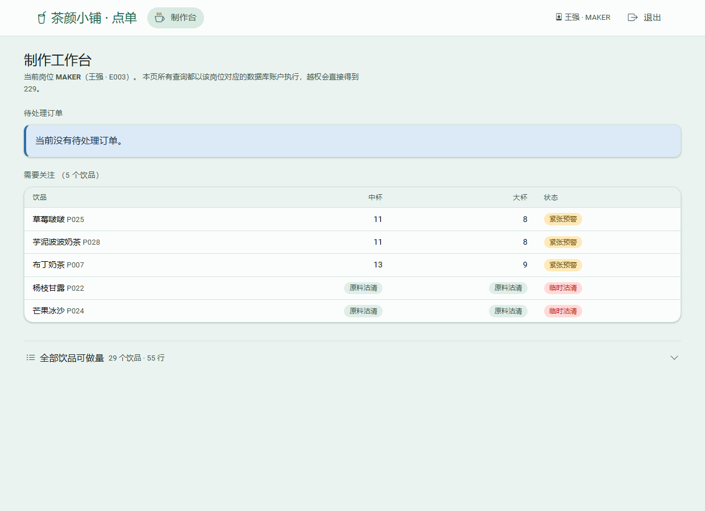

*图 4｜制作台。上：待处理队列（每行"推到下一状态"或"取消"）；下："需要关注"的 5 个饮品，杯型作列；29 个饮品 55 行的全量数据在折叠区。*

### 收银台

这页是被"登录即会员"逼出来的。我们的口径是能登录的人那一刻就是会员，系统没有游客态；柜台前不想登录的顾客，就由收银员代客下单，手机号留空即散客单（`member_id` 为 NULL），不产生积分，也不占会员的券。

卡片、弹窗、购物车全部和顾客页共用同一套模板（`_menu_cards.html` / `_cart_shell.html`），差别只有顶上多一个手机号输入框。表单契约因此完全一样，还是五个平行列表：`product_id` / `cup_spec_id` / `sugar_spec_id` / `ice_spec_id` / `qty`，加料用 `topping_id_<序号>`，`_parse_items()` 一行没改。

收银员在库里没有 `tbl_ingredient` / `tbl_stock_ledger` 的权限，下单又要扣库存，所以写入这一段跑在 `dbo` 身份下。这是权限上的妥协，v2.0 打算改成存储过程加 `EXECUTE AS OWNER`（§5.2），我们把它写进报告，没有绕过去。

### 顾客侧四页

菜单的数据来自视图 `vw_product_stock_availability`，可做杯数和原料沽清都已经算好，按分类分组展示。杯型从表格的一列改成卡片里的选项，卡片只写"¥4.00 起"；整款做不了才进"今日售罄"区，"可做 N 杯"这种数字干脆不显示。

定制用 Bootstrap 原生 modal，卡片列表保持整齐，定制项一次只出现一组。里面五个控件都是原生 `select` / `input`，没有 JS 也能提交，JS 只管实时小计和"已选几杯"的徽标。

购物车的状态不另存一份，就存在每个弹窗里那个 `qty` select 上，提交的表单和购物车显示的永远是同一份数据。购物车为空时底部悬浮栏整个隐藏。

券的三态（可用 / 已用 / 已过期）由查询算出来，不加字段。下单时服务端校验四件事：属于本人、未使用、在有效期内、达到门槛，然后 `discount = min(面额, 订单金额)`。核销放在提交前最后一步，靠 `UPDATE ... WHERE status='UNUSED'` 的影响行数判断有没有被人抢先用掉，被抢了整单回滚。

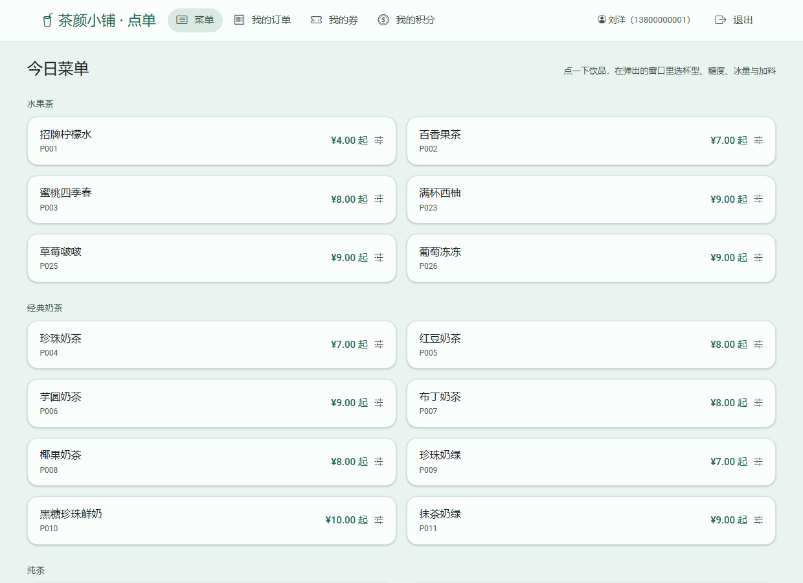

*图 5｜顾客首页：按分类分组的饮品卡片，显示名称、编码、"¥4.00 起"。*

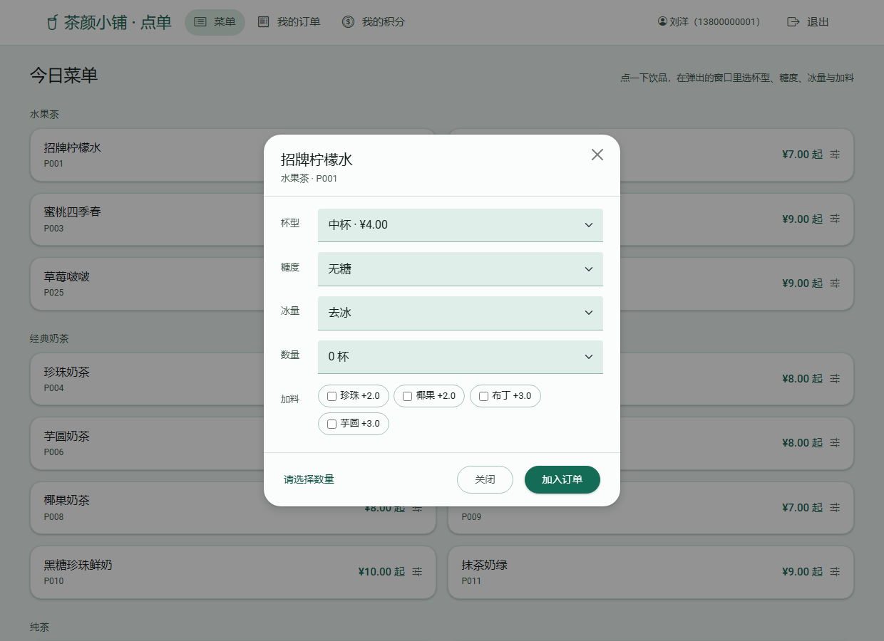

*图 6｜点开"招牌柠檬水"后的定制窗口：杯型（带价格，售罄杯型不可选）、糖度、冰量、数量、加料，底部实时算出小计。*

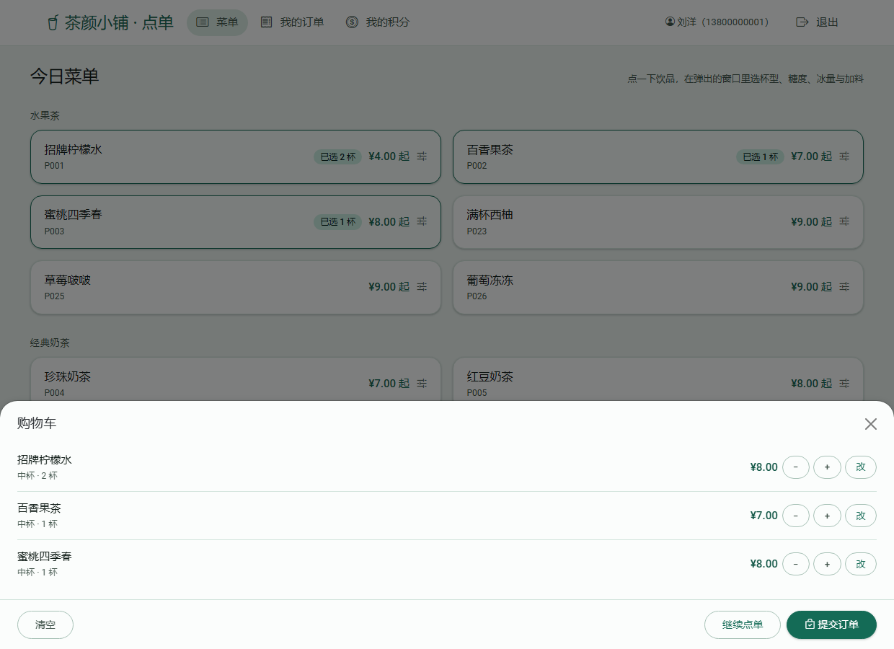

*图 7｜选中几杯后出现底部悬浮价格栏，点开是购物车面板：每行"名称 / 杯型·杯数·加料份数 / 金额"，底部"清空 / 继续点单 / 提交订单"。*

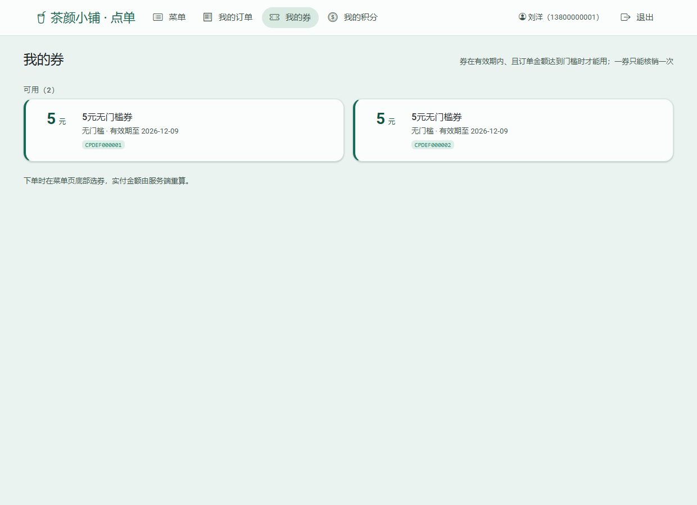

*图 8｜"我的券"页：可用券 2 张（5 元、无门槛、有效期至 2026-12-09、券号 CPDEF000001/2），已用与已过期收在折叠区。*

## 2.3 出错的时候，用户看到什么

课程要求"有错误提示"，我们把它当成硬指标：**每个错误都落到统一的卡片页，带错误码和请求标识**。

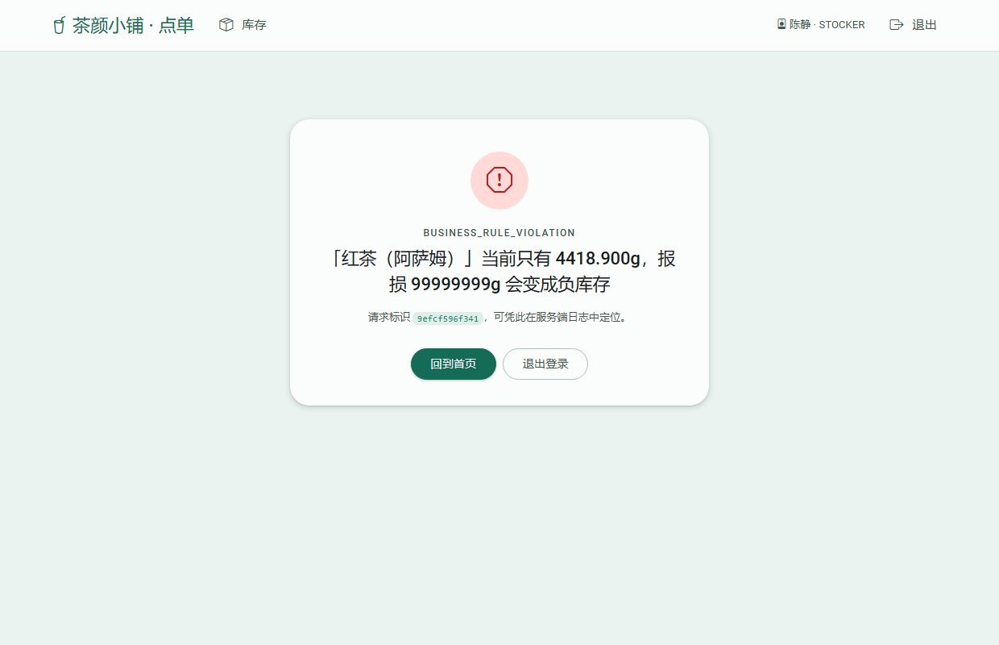

*图 9｜库管报损 99999999g（远超结存）时的界面：`BUSINESS_RULE_VIOLATION`，正文"〔红茶（阿萨姆）〕当前只有 4418.900g，报损 99999999g 会变成负库存"，下面带请求标识，方便对着服务端日志排查。*

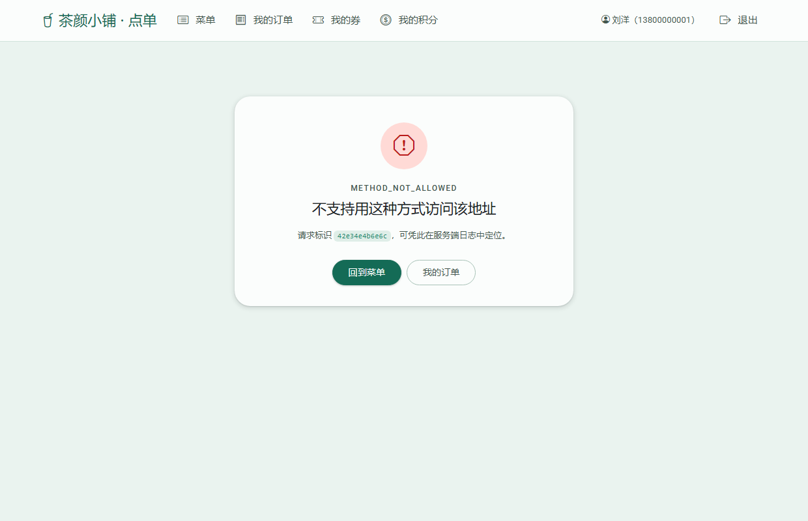

*图 10｜用 GET 访问只接受 POST 的 `/order`。这张图盯着一个真实回归：早先这个错误被兜底 handler 吞成 500，用户看到"服务器内部错误"，其实是自己访问方式不对。*

八类异常到 HTTP 的映射是固定的：`INPUT_INVALID → 400`、`UNAUTHENTICATED → 401`、`PERMISSION_DENIED → 403`、`NOT_FOUND → 404`、业务规则/约束冲突 → `409`、连接失败 → `503`、其余 → `500`，全部带 `request_id`。

---

# 3. 测试：我们怎么证明"改完没改坏"

## 3.1 四层验证，每层各管一段

| 层 | 怎么跑 | 管什么 | 证明不了什么 |
|---|---|---|---|
| ① 接口测试（pytest） | `cd project/app && python -m pytest -q` | 46 条：结构 8 / 权限 9 / 岗位工作台 21 / 订单取消 3 / 券核销 5 | 进程内调用，不是真 HTTP，没有并发 |
| ② 数据库回归 | `sqlcmd -b -i project/tests/regression.sql` | 15 项硬断言，失败 `THROW` 出非零码 | 只断言种子口径，不管运行期新增数据 |
| ③ 基线快照 | 三份 `baseline/*.sql` 与迁移前输出逐行比 | 订单明细 / 商品销售 / 库存查询 293 行零差异 | 只覆盖有快照的这三块 |
| ④ 真 HTTP + 真库 | 浏览器点、`curl` 打状态码、直查库 | 角色隔离、错误码、并发下的表现 | 靠人工，不可回归 |

## 3.2 15 项回归断言

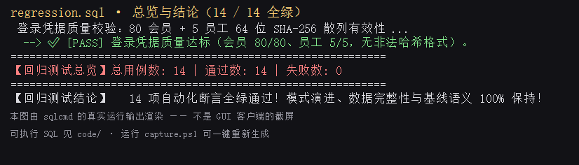

*图 11｜`regression.sql` 的结尾。总用例 15、通过 15、失败 0，最后一行"15 项自动化断言全绿通过"；上面那条是 TC-15（角色授权与越权防护）。*

15 项大致覆盖：表/字段/约束计数、券模板与券实例、兼容视图行数、三条"非法写入必须被拒"的负例、两条"合法写入必须成功"的正例、销售额 D 口径、明细金额恒等式、库存不变量、积分台账、登录凭据格式、角色授权。

TC-10 值得单独说：它断言的是**种子口径**（`business_date < '2026-10-01'`）的销售额 = 1,926 单 / 23,762.00 元，运行期新增的订单只打印、不参与断言。早期版本把全库绝对数字写死了，我们自己下一单测试数据它立刻变红——**测试盯着业务增长是错的，应该盯设计不变量**。

## 3.3 基线快照：迁移前后业务结果必须一样

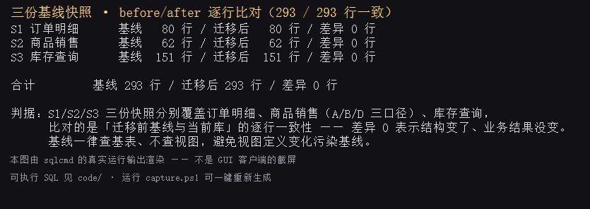

*图 12｜三份快照与迁移前输出逐行比对：订单明细 80 行、商品销售 62 行、库存查询 151 行，合计 293 行、差异 0。首行的"差异"只是 BOM，不是内容。*

## 3.4 三个口径 / 库存不变量 / 销量榜

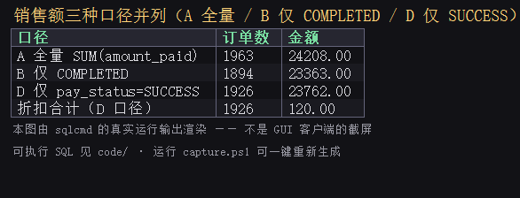

*图 13｜同一段数据三种销售额口径对照：A 全量 1,963 单 / 24,208.00；B 仅 COMPLETED 1,894 单 / 23,363.00；**D 仅 `pay_status='SUCCESS'` 1,926 单 / 23,762.00**（主口径）。差额能逐项解释：折扣 120.00、退款 446.00、未完成订单等。*

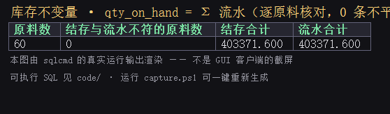

*图 14｜60 种原料的结存合计 403,371.600 与流水合计 403,371.600，不符行数 0。*

## 3.5 权限：能进哪个页面由数据库说了算

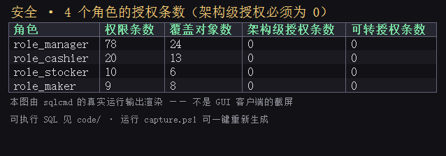

*图 15｜四个角色的授权条数与覆盖对象数：店长 78 条 / 24 个对象、收银 20/13、库管 10/6、制作 9/8，架构级授权 **0** 条。*

店长这个角色原本拿的是 `GRANT ... ON SCHEMA::dbo`——意思是"以后新建的任何表也自动给店长权限"。我们改成 22 条逐对象授权，并用一张探针表验证：改之前店长能查新建的表，改之后直接被拒（错误 229）。

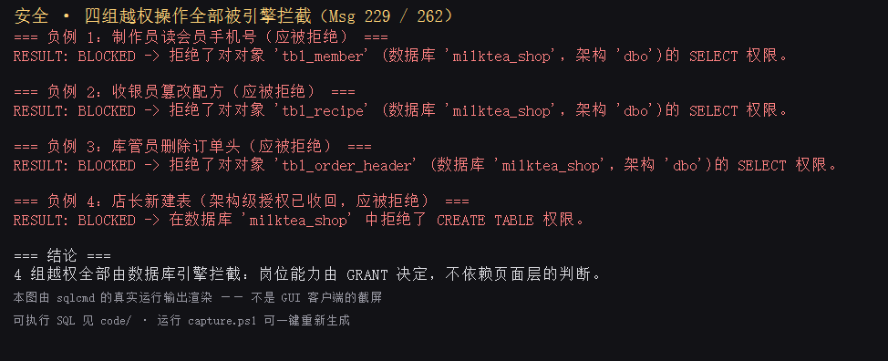

*图 16｜四组越权全部 `BLOCKED`：制作员读会员表、收银员改配方、库管员删订单、店长建表。*

---

# 4. 遇到的八个问题

按"现象 → 怎么定位 → 根因 → 怎么修 → 怎么证明"写。写这么细是因为其中一半是**我们自己的设计缺陷**，不写等于假装没发生过。

### 问题 1｜80 位会员的积分余额，一条都对不上

- **现象**：余额合计 25,224，流水合计只有 14,401，逐人核对 **80/80 全不符**。
- **定位**：翻造数脚本 `generate_seed.py`，发现 `points_balance` 是直接写死的随机数，从没生成对应流水；而库存那边有期初流水（`ledger_type='PURCHASE_IN'`、`ref_type='OPENING'`），所以库存对得上、积分对不上。
- **根因**：模型缺一类流水——"期初结转"。也说明了补不进去的原因：两条 CHECK 分别要求 "EARN 必须挂订单" 和 "REDEEM 必须挂券"，期初行既没订单也没券。
- **修法**：迁移 03 加 `OPENING` 类型、放宽 target 约束、回填 80 条期初（时间取注册日 00:00，保证早于任何消费）。
- **证明**：迁移脚本末自证「余额合计 25,224 = 流水合计 25,224、不符会员 0」，当时的查询输出见 [`points-reconcile.png`](result/02-migration/points-reconcile.png)；回归里 TC-13 每次都会重算这条等式。

### 问题 2｜时间戳的先后顺序没人管

- **现象**：`pay_time` 可能早于 `order_time`，`finish_time` 可能早于 `pay_time`，库里没有任何约束拦。
- **定位**：把 `tbl_order_header` 的 9 条 CHECK 全列出来看（`sys.check_constraints`），只有 `ck_order_header_finish_time` 约束了"完成不早于下单"，缺另外两条相对顺序。
- **修法**：迁移 04 加 `ck_order_header_pay_time`（`pay_time >= order_time`）与 `ck_order_header_finish_after_pay`（`finish_time >= pay_time`）。
- **⚠️ 有一条我们特意没做**：还想加"`pay_status` 非空 ⇒ `pay_time` 非空"，但库里有 **37 张单**支付状态有值却没有支付时间（历史弃单/取消单），硬加会让迁移直接失败。最后决定如实标注为历史数据，不追。

### 问题 3｜单价有两套精度

- **现象**：金额列 `DECIMAL(10,2)`，但采购明细单价是 `(12,4)`、原料移动平均成本是 `(10,4)`。
- **根因**：两批人分头建表，口径没统一。
- **修法**：迁移 05 把 6 个单价/成本列统一到 `(12,4)`（先删 6 条旧 CHECK → ALTER → 重建 → `sp_refreshview`）。

### 问题 4｜店长手握 `SCHEMA::dbo` 全权

- **现象**：审计授权时发现 `role_manager` 只有 4 条授权，但覆盖整个 `dbo` 架构。
- **根因**：图省事。
- **修法**：改 22 条逐对象授权；用探针表验证——改前店长能查新建表，改后报 229。
- **证明**：图 15、图 16。

### 问题 5｜`GET /order` 返回 500 而不是 405

- **现象**：用 GET 访问只接受 POST 的路由，页面显示"服务器内部错误"。
- **定位**：`app.py` 里有个兜底 `@app.errorhandler(Exception)`，把 `HTTPException`（405/400 这些）也一起吃掉了。
- **修法**：单独注册 `@app.errorhandler(HTTPException)`，按异常名映射错误码。
- **证明**：图 10，现在是 405。

### 问题 6｜库管台"补货预警"整列空白

- **现象**：预警表"预警"列一个字都没有，标题却写着"低于补货点"。
- **定位**：模板取 `a[12]`，而 DAO 只 SELECT 了 11 列（0—10），`a[12]` 是 Jinja 的 undefined，渲染成空。
- **根因**：视图有 14 列、DAO 只查 11 列、模板按下标取，三处各自演进没人对齐。顺带发现另一个问题：视图里"库存健康"的 55 行也被算进"低于补货点"，60 行里只有 5 行真的要处理。
- **修法**：DAO 加 `WHERE alert_priority < 5`，模板改取 `a[9]` / `a[10]`，按档位分色。
- **证明**：图 3，5 条 + 三档徽章。

### 问题 7｜购物车面板只露出两行

- **现象**：购物车打开后只能看到 2 行，第 3 行被截。
- **定位**：`getComputedStyle` 量出高度是 242px（= 30vh），说明我们自己写的 `.cart-sheet` 规则根本没生效。
- **根因**：Bootstrap 的 `.offcanvas.offcanvas-bottom` 是**两个类**（优先级 0,2,0），写死 `height: 30vh`；我们的 `.cart-sheet` 只有单类（0,1,0），压不住。
- **修法**：选择器改 `.offcanvas.cart-sheet`，`height: auto; max-height: 74vh`。

### 问题 8｜趋势图把 46 天空档连成"断崖"

- **现象**：店长台折线从 9 月 23 日（2,911 元）直接连到 11 月 8 日（12 元），看上去像经营崩了。
- **根因**：种子数据只到 9 月 23 日，横轴把两个日期直接拼在一起，中间 46 天没有点。
- **修法**：有缺口时插一个占位标签（`09-24~11-07`）、三个序列填 `null`，折线设 `spanGaps: false` 断开。
- **证明**：图 2 左上那张图，折线在 09-23 之后断开，11-08 是孤立一点。

---

# 5. 总结

## 5.1 对照课程的七项任务

| # | 任务 | 完成情况 | 证据 |
|---|---|---|---|
| 1 | 准备 v1.0 库与基线 | ✅ | `result/01-build/` 的对象统计与行数两图 + 图 12（基线比对） |
| 2 | 分层搭建 | ✅ | `project/app/` 三层 + `test_layering.py` 三条断言 |
| 3 | 数据访问层 | ✅ | `dao/` 11 个模块，唯一 import `pyodbc` |
| 4 | 业务层与请求处理 | ✅ | `service/` 10 个模块，21 条路由 |
| 5 | 界面增删改查 | ✅ | 四个岗位工作台（图 2—4）+ 顾客四页（图 5—8） |
| 6 | 角色界面 | ✅ | 四岗位与数据库四角色一一对应（图 15） |
| 7 | 集成测试与交付 | ✅ | 46 条应用测试 + 15 项回归 + 293 行基线 + 37 图证据 |

**三个评分点各自还差什么**（我们更愿意主动说）：

- **设计合理性**：规范化论证到位，但 **A13"在售商品至少一条配方"至今没在库层强制**——它需要跨表断言，单表 CHECK 表达不了，只能靠服务层校验。这是已知缺口。
- **迁移正确性**：七段迁移都带自证，但**脚本不保证可重复执行**（课程不要求）；要重跑必须先回到干净状态，这点写在 README 里。
- **应用完整性与可用性**：四个岗位都能走通，但 **会员看不到自己的积分流水**（数据库角色没有 `tbl_points_ledger` 的 SELECT 权限，放开又等于让收银员能读全部会员流水）。界面上给了明确提示，没有假装有数据。

## 5.2 下一步（v2.0 打算做什么）

1. **程序对象**：把"下单"整段下沉成存储过程 + `EXECUTE AS OWNER`。现在下单跨订单域与库存域，只能用 `dbo` 身份写，属于权限上的妥协。
2. **事务与并发**：现在查库存和扣库存之间有窗口（TOCTOU）。打算按 `ingredient_id` 升序加锁 + 写一个可控并发脚本把竞态复现出来，再证明锁能解决。
3. **盘点两表**：`tbl_stocktake` / `tbl_stocktake_detail` 从第 6 周就延后了，v2.0 补上，让"盘点差异"有地方落。

---

# 附录

## 附录 A · AI 使用记录（摘要）

完整记录见 [`ai-log.md`](ai-log.md)（11 条使用记录、6 条业务口径类纠错、10 条被否决的方案）。这里只留几条最能说明问题的：

| AI 给的建议 | 我们最后的判断 | 结论 |
|---|---|---|
| 用 121 或 161 列写"v0.1 有 XX 个字段" | 用括号感知解析重算，得 **132** | AI 数错了 |
| 报告"week1 从未被反向同步"是本次新发现 | 检索发现第 2 周已裁决，只是没回写 | AI 凭印象下结论 |
| 沿用"12 BCNF + 5 反规范化"的旧口径 | 拆表后应为 15 + 3 | 口径过期 |
| 把"库存健康"的 55 行也算进"低于补货点" | 只有 5 行需要处理 | 语义理解错 |
| 用"商品×杯型×糖度"组合判断配方覆盖率 | 糖度不是覆盖维度，无糖本就不耗糖 | 判据错 |
| 加"`pay_status` 非空 ⇒ `pay_time` 非空" | 有 37 张历史单是反例 | 会误伤数据 |

我们给自己定的纪律：**AI 的产出只有两种状态——能被命令复算的，和不算证据的**。

## 附录 B · 组内分工

本阶段共 **132 个提交**（`git log --no-merges --all`，截至 2026-11-09）：

| 指标 | DiSod | 何争霖 |
|---|---:|---:|
| 提交数 | 110 | 22 |
| 触及文件（去重） | 363 | 80 |
| 增删行 | +82,556 / −2,406 | +28,950 / −1,348 |
| 最近提交 | 2026-11-09 | 2026-11-04 |

**分工概览**（完整版见 [`contributions.md`](contributions.md)）：

- **DiSod**：ER 图与业务规则、数据库迁移（7 段）与验证、应用三层与四个岗位工作台、界面 MD3 重构、订单取消与券核销，以及本阶段交付材料（报告 / AI 记录 / 结果证据 / 操作手册）。
- **何争霖**：Issue 看板与造数引擎、CRUD 健壮性、第 4 周查询与视图、`normalization.md` 与券拆表迁移、回归测试与基线快照、ISSUE-012/013/014 闭环。

> ⚠️ 何争霖部分为依据提交记录的整理，已请其本人确认（见 `harness/issues/020-v1.0-contributions-fill-in.md`），确认后以其本人表述为准。
